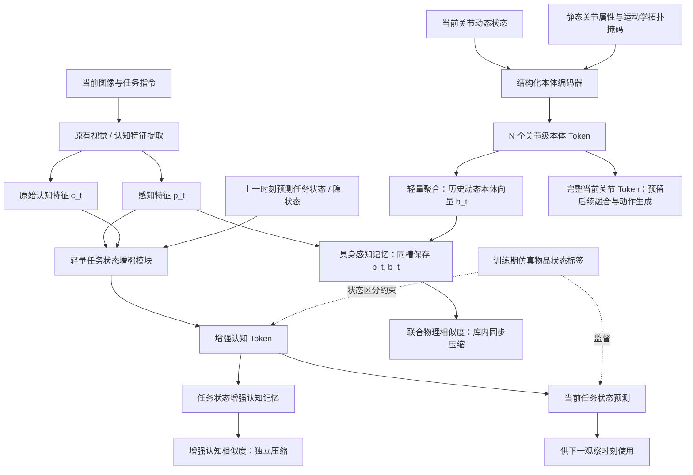

# 具身感知与任务增强认知双记忆：记忆构建设计草案

- 日期：2026-11-25（北京时间）
- 状态：研究讨论形成的主架构候选，尚未实现、尚未验证。
- 范围：仅记录特征准备、记忆槽位结构、写入和压缩；不下达训练任务，不修改现有 V1/V2/V3 实验，不提前确定检索、融合与动作注入的具体实现。
- 面向：GR00T N1.6 + MemoryVLA，移动双臂机器人（底盘、升降、左右臂等复杂运动机构）。

## 1. 研究动机与设计结论

当前希望解决两个不同的问题：
1. 原始认知特征可能隐含任务状态，但在记忆相似度空间中不一定足以区分关键任务进展，导致重要历史被压缩或检索不准。
2. 历史视觉特征不能保证完整表达机器人自身的运动状态与外部环境之间的对应关系；复杂本体的历史运动可能为后续协同操作提供额外信息。

当前主方案：保留两个记忆库，分别构建 **具身感知记忆库（Embodied Perceptual Memory）** 与 **任务状态增强认知记忆库（Task-state-enhanced Cognitive Memory）**。两个库独立管理、独立压缩，不要求其槽位时间对齐。具身感知库内部的视觉和本体特征保持对应并同步更新。

不采用早期讨论的“两个库都额外存任务状态与本体向量”方案；暂不新建第三个本体记忆库；不提前用 MLP 将历史视觉、本体混为一个不可分辨的向量。

## 2. 总体数据流（到记忆构建为止）

感知与原始认知特征沿用现有提取接口；实际张量形状以仓库实现为准。图中箭头描述逻辑数据依赖，并非已经实现的代码。

## 3. 具身感知记忆库

### 3.1 本体特征准备

借鉴 BodyVLA 的关节级表达思路：将关节静态属性、当前动态状态、由运动学拓扑确定的注意力掩码编码为一组关节 Token：

$$
B_t = E_b(q_t, a_{static}, G),\quad B_t\in\mathbb R^{N\times d_b}.
$$

其中 $q_t$ 表示可用的当前本体动态观测，不引入未来动作或额外传感模态；$G$ 是已知机构拓扑。将这些 Token 轻量聚合为历史本体向量 $b_t$。此前讨论过任务引导的注意力池化，但在新双库架构中是否使用任务条件、如何保留不同自由度的动态信息，尚未锁定。固定机器人静态机构属性不需要另作为历史数据重复存储，但可以用于动态特征编码。

完整的当前关节 Token 仍保留给后续记忆利用与动作生成；聚合向量不替代它们。

### 3.2 槽位结构

一个槽位表示同一历史观测（压缩后可能对应一段时间范围），其中分别保存：
- 原始感知特征 $p_i$（保留其 Token 结构，不要求与本体维度相同）；
- 历史动态本体特征 $b_i$；
- 可选的维护元数据，例如时间范围及合并计数 $n_i$。

即 $M_i^p=(p_i,b_i)$。示意若容量为 16，就是 16 个槽位，每个槽位关联两组特征，而不是 32 个历史槽位。容量 16 仅为讨论示例，不是正式超参数。

### 3.3 压缩准则

沿用相邻历史合并的基本思路，但采用联合物理距离：

$$
D_{ij}^{p}=(1-\alpha)d_p(p_i,p_j)+\alpha d_b(b_i,b_j),\quad 0\le\alpha\le1.
$$

例如 $d_p,d_b$ 可采用各自归一化后的余弦距离。感知若为多 Token，须定义与原实现一致或明确的固定维度比较方式；本体的关节角、位移尺度及角度周期等须在编码或度量中妥善处理。

在等权、单位归一化的向量情况下，两个向量取算术平均时，两个样本的平方重构误差之和恰为 $1-\cos(x_i,x_j)$。所以联合距离具有明确的局部重构损失解释。等价地，将两组单位特征分别乘以 $\sqrt{1-\alpha}$ 和 $\sqrt{\alpha}$ 后拼接，其余弦相似度就是两个原始余弦相似度的加权和。该解释针对度量空间，并不要求实际将两个特征混合存储。

当记忆超过容量时，从时间相邻候选中选择联合压缩代价最低的一对，并对该对的感知和本体特征同步执行合并，保留相同的时间范围。候选合并方式是按原始观测数加权平均；若槽位已经包含多个样本，精确的增量平方重构损失（对固定欧氏特征空间中的未重新归一化质心）为：

$$
\Delta_{ij}=\frac{n_i n_j}{n_i+n_j}
\left[(1-\alpha)\|\mu_i^p-\mu_j^p\|^2+
\alpha\|\mu_i^b-\mu_j^b\|^2\right].
$$

此式适用于对应的均值表示，不应把重新归一化后的质心余弦距离直接宣称为完全等价。具体使用原有余弦合并还是上述带计数准则仍待决定；权重与保护规则未确定。

物理意义：尽量避免仅因为视觉相似，就合并机器人自身状态差异显著的历史。反过来，姿态变化也不必然有任务价值，因此不应让本体分数无条件主导压缩。

## 4. 任务状态增强认知记忆库

### 4.1 增强方式

不另存任务状态向量，而是利用任务监督增强原有认知 Token。候选轻量残差结构：

$$
\tilde c_t=c_t+f_\theta(c_t,p_t,h_{t-1}),\qquad
\hat s_t=g_\phi(\tilde c_t).
$$

$h_{t-1}$ 为上一观察时刻预测状态或估计器隐藏状态；$\hat s_t$ 预测的是当前物品状态而非未来真实状态。推理只使用可观测输入及模型自身历史预测，不能依赖仿真真值标签。初始状态和跨示范重置规则待细化。可考虑让当前本体信息参与状态估计，但不是已经锁定的输入，也不把完整本体向量再存入认知库。

训练阶段使用物品状态标签（如门开关、物体是否放入等），监督状态预测。为使该监督真正作用于压缩依赖的相似度空间，候选目标为：

$$
\mathcal L_{state}=\mathcal L_{pred}+\beta\mathcal L_{metric}.
$$

例如同一任务中关键物品状态不同的样本对，采用余弦距离下限约束：

$$
\mathcal L_{metric}=\max(0,m-d_{cos}(\tilde c_i,\tilde c_j)).
$$

不强制相同任务状态的所有认知特征完全相同，以保留其他语义信息。标签定义、配对策略、距离约束形式和权重均待细化。状态预测准确不代表余弦相似度天然能区分状态，所以需要明确检查度量空间。

### 4.2 写入与压缩

每个认知槽位仅存增强认知特征 $\tilde c_i$（及必要维护元数据），维度原则上与原认知 Token 一致。压缩时以相邻增强认知特征的相似度判断冗余，合并策略可沿用原机制并作必要调整。

该库独立于具身感知库运行，因此两库同编号槽位不代表同一历史时刻。任务标签在训练阶段使用，不是推理时额外存入的真值特征。

## 5. 理论依据与边界

设 $X$ 为当前输入及原有历史信息，$H_b$ 为历史本体，$A$ 为动作标签。平方损失下，增加历史本体后的最优预测风险减少量为：

$$
R(X)-R(X,H_b)=\mathbb E\|\mathbb E[A\mid X,H_b]-\mathbb E[A\mid X]\|^2\ge0.
$$

若历史本体能提供额外的动作预测信息，则存在收益可能；该结论不证明固定记忆容量、有限模型和实际训练条件下必然有收益，也不证明当前双库架构全局最优。联合压缩公式仅给出所选特征空间中的局部重构依据，不等于任务效用最优。

对比独立第三库：同槽保存视觉和本体可保留其压缩时的时间关联。对比全部特征混合：分别保留允许分别度量、诊断及后续使用。对比在两个库重复加入本体与任务状态：目前的分工减少冗余，但不声称两类信息统计独立。对于复杂移动双臂任务，这是当前优先考虑的理论架构，而不是已经获得实验支持的结论。

## 6. Agent 阅读边界：哪些已定、哪些未定

**当前确定的设计方向：**
- 两个记忆库；具身感知库内视觉与动态本体独立表达、联合存储、联合压缩；任务增强认知库使用增强认知 Token，不单独存任务状态向量。
- 两库独立压缩；仅具身感知库内部的视觉与本体同步合并。
- 当前完整关节级本体 Token 预留后续利用，避免仅依赖离散检索的间接动作梯度。

**仍待讨论，不要自行当作正式实现规格：**
- 本体聚合方式、动态本体具体输入及维度、压缩权重、合并规则、容量、任务状态标签与距离损失细节。
- 训练中历史编码是否保留梯度、跨时刻状态如何截断等；硬合并或硬 Top-K 本身不可微，不能假定压缩决策会被动作损失直接优化。
- 记忆检索的具体评分、返回与权重计算；压缩的相似性不必等于动作所需的历史相关性。
- 记忆融合、动作专家注入、损失权重、训练与验收实验。
- 此文档不修改或替代现有实验任务书；不据此自动启动训练或重构现有模块。
