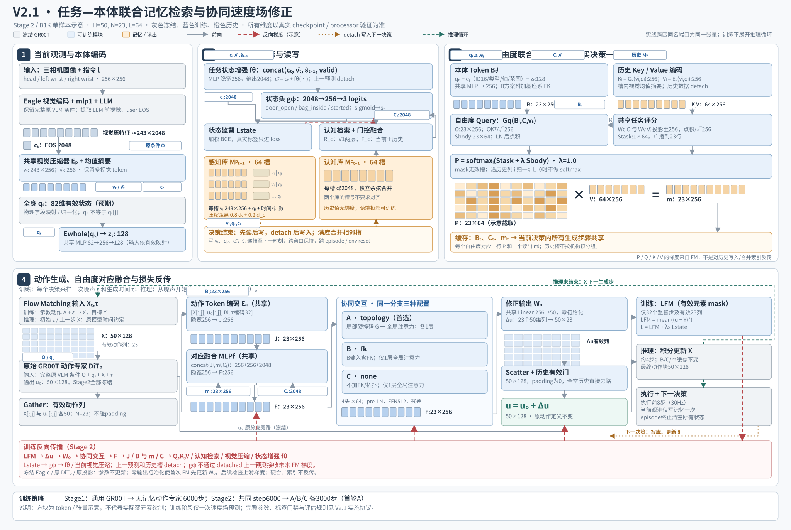

# 具身记忆研究架构：版本导航

**当前开发目标：V2.1（A 拓扑优先，B 正运动学，C 基础对照）。** 设计尚未实现或正式训练；原 V1/V2/V3 既有实验保持历史身份。

## 当前版本：按以下顺序阅读

| 文件 | 职责 |
|---|---|
| [V2.1 完整架构](V2.1_embodied_memory_architecture.md) | 科学问题、统一公式与符号、模块原理、A/B/C |
| [V2.1 详细网络图 SVG](V2.1_detailed_network.svg) | 一张完整的 Token 级前向与反向、双库读写、动作维度、配置切换图，可放大 |
| [V2.1 实现、训练与评估协议](V2.1_implementation_protocol.md) | **代码开发与实验参数的唯一主协议**：张量、网络宽度、两阶段权重与冻结、标签、评估与门禁 |
| [V2.0 基础架构](V2.0_embodied_memory_architecture.md) | 历史设计，保留理论与演进依据 |
| [早期记忆构建设计](2026-11-25_memory_construction_design.md) | 历史讨论，不能覆盖 V2.1 读端本体编码与压缩决定 |

## 相关源码、数据和评估依据

- [V1 源码与运行说明](../../src/v1_groot_memoryvla/README.md)：原始 GR00T 和记忆训练接口。
- [V1 顺序窗口训练协议](../../src/v1_groot_memoryvla/RETRAIN.md)：数据、mask、训练步数参考。
- [历史 V2 状态监督实验报告](../../Output/test_02/experiment_01/report.md)：标签认证与失败诊断，不是新架构实现。
- [公共评估协议](../../evaluation/evaluation.md)：正式闭环条件和指标。
- [工作台执行手册](../workbench_agent.md)：实际设备、预检、运行快照与资源管理。

新代码拟在 `src/v2_1_groot_memoryvla/`，目前尚未在本目录声明已实现；旧 V2 源码需从本地或固定快照核查。V2.0/V2.1 是原 V1.0/V1.1 研究设计稿重新编号，原 V2 实验结果不能当作 V2.1 的结果。V1.2 讨论稿已取消。

## 后续讨论与开发约定

1. 新对话或 Agent 接续先读取本导航、V2.1 架构与实施协议，不根据旧日期文档重新构思。
2. 统一公式沿用 V2.1 符号表，新增变量需定义含义、维度和梯度边界。
3. 网络结构变更应同步更新 SVG 大图、架构正文和实施协议；运行参数变化写入协议并记录缘由，不改历史运行。
4. 训练配置由实施协议主导；架构图用于理解数据流，不作为未经核验的 CLI 或真实张量证明。
5. 每次正式开训前完成标签、真实模型形状、动作通道映射、拓扑/FK、梯度和资源门禁，不能以设计稿代替测试结果。
