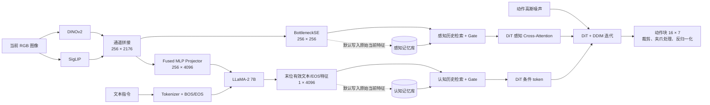

# MemoryVLA：从一帧图像，到有记忆的机器人动作

> 中文源码讲解视频脚本 / 动画制作输入文档。建议成片 12 分钟、16:9、1920×1080、30 fps。分析日期：2026-11-13。
>
> 对象是本工作区 `src/references_code/memoryvla` 中基于 OpenVLA 的 MemoryVLA。不是旁边的 GR00T 记忆改造版本，也不是 MemoryVLA+ / MemoryVLA++。

## 给 Opus 的制作任务

请根据本文制作中文技术讲解动画。保留第 4 节的镜头编号、概念顺序、旁白含义和张量维度；旁白可为口语节奏微调。以第 2、3、5 节为技术依据，以第 6 节为源码索引。画面用可编辑的矩形、token 网格、连线、时间轴和公式构建，避免把整篇文档直接做成幻灯片。

每个镜头只突出一个核心变化。右下角保留全局架构小地图，标示当前讲到哪一部分。形状标注统一为 `[batch, tokens, channels]`，动作张量另标 `[batch, horizon, action_dim]`。出现第一个维度为 2 时，明确它是训练 batch 还是 CFG 的两分支，不能把二者混用。

片头用一次清楚的说明：“依据参考源码与随机权重前向实测，讲解结构与数据流。”实验镜头显示“随机权重 / 合成输入”；概念性的机器人成功动作、物体遮挡和注意力热图标为“原理示意”。本次没有机器人 rollout 或训练后策略评测，不要把示意动画包装成实验成功录像。

优先制作完整的结构讲解；不用增加排行榜、论文成绩或其他模型的性能比较。代码来源与证据放在片尾或配套说明，不占据主体画面。

## 1. 本次实际执行了什么

读取并串联了数据构造、视觉主干、VLM、双路记忆、DiT、扩散训练与部署代码。使用原始模块的实际计算方法，在 GPU 上运行完整尺寸的随机初始化网络：DINOv2 ViT-L、SigLIP SO400M、LLaMA-2 7B、两路记忆模块、DiT-L。

未载入训练权重。输入是程序生成的 `224×224` RGB 坐标色块图，文本指令是 `put the red block into the bowl`；动作标签及反归一化统计均为合成数据。文本使用 OpenVLA 的原始 `tokenizer.model`。探针仅替换构造阶段的权重下载和配置加载，未改参考源码，也未用假的模块输出来替代网络前向。

| 项目 | 本次记录 |
| --- | --- |
| 设备 | NVIDIA GeForce RTX 4090，`cuda:0` |
| Python / PyTorch | 3.10.12 / 2.7.1+cu128 |
| Transformers / timm | 4.40.1 / 0.9.10 |
| 数值精度 | 模型参数 BF16；训练入口使用 autocast，部分中间量与损失为 FP32 |
| 参数量 | 8,376,742,631，约 83.77 亿 |
| 训练入口 | `B=2`，同一 episode，观测时间戳 `[0,8]`，扩散重复数 `R=4` |
| 训练返回 | `loss=1.0629347563`，以及 `CausalLMOutputWithPast` |
| 部署入口 | 首帧、带历史、再次首帧重置，三次均返回两个 `[16,7]` 数组 |
| 采样参数 | `cfg_scale=1.5`、DDIM 10 步、动作窗口 `15+1=16` |
| 容量验证 | 原尺寸双库连续写入 18 次，容量均保持不超过 16 |
| 记录数量 | 492 条模块/记忆调用事件 |
| 本进程峰值 GPU allocated | 16.31 GiB；不是设备总占用，也不是训练显存需求 |

本次记录的是结构执行证据。随机初始化的 DiT 最终线性层按源码被置零，所以本次预测噪声为零；输出动作主要由初始随机噪声、采样器和裁剪产生。不能据此判断动作质量，或把不同请求之间的动作差异归因于记忆效果。记忆检索和融合本身的非平凡中间输出已被记录。

原始记录见 [forward_trace.json](forward_trace.json)，执行脚本见 [probe_forward.py](probe_forward.py)，复现说明见 [README.md](README.md)。JSON 包含形状、dtype、部分数值统计、动作完整数组、记忆前后状态与所有参考 Python 文件的 SHA-256。相同阶段同名模块反复调用时，首次记录统计量，后续主要记录形状；不是所有激活的完整转储。

## 2. 一张图理解实际数据流



这张图表达数据依赖。实际代码先计算当前图像和认知特征，再调用认知库、感知库，最后进入动作模型。每个记忆库内部执行“读取旧历史 → 融合当前特征 → 写入当前条目 → 必要时合并”。历史记忆进入动作专家之前的表示，不重新送回 LLaMA 的输入序列。

### 固定符号

| 符号 | 含义 | 本文取值 |
| --- | --- | --- |
| `B` | 一次网络前向的观测样本数 | 训练探针 2；单次部署 1 |
| `L` | 文本序列长度，含特殊 token | 此指令为 24；其他指令会改变 |
| `P` | 当前图像空间 patch 数 | 256，即 `16×16` |
| `D_v` | 双视觉特征拼接宽度 | `1024+1152=2176` |
| `D_c` | 认知 token 宽度 | 4096 |
| `D_p` | 感知 token 宽度 | 256 |
| `M` | 某一路当前实际存储的历史条目数 | 0 到 16 |
| `H` | 动作块长度 | 16，包括当前动作和后续 15 个动作 |
| `D_a` | 每个动作的维度 | 7 |
| `R` | 训练时动作/条件的重复次数 | 4 |
| `τ` | episode 观测时间戳 | 与扩散时间不同 |
| `s` | 扩散噪声等级/时间步 | 训练取 0 到 99；本次采样使用 10 个选定等级 |

## 3. 输入、输出与逐模块形状

### 3.1 两个入口不能混为一谈

`MemoryVLA.forward()` 是训练入口。输入包括 token IDs、文本 mask、双视觉预处理图像、动作标签、episode ID 和时间戳；输出是 `(diffusion_loss, vlm_output)`。它没有直接返回一条可执行动作轨迹。

`MemoryVLA.predict_action()` 是部署入口。输入 PIL 图像、字符串指令、统计量选择键、采样参数和字符串形式的 `episode_first_frame`；输出是 `(actions, normalized_actions)`。两者形状均为 `[16,7]`。函数注解中的单个 `np.ndarray` 没有完整描述实际返回值，以函数末尾的 tuple 为准。

```text
部署调用示意：
actions, normalized_actions = model.predict_action(
    image=<PIL RGB image>,
    instruction="put the red block into the bowl",
    unnorm_key="synthetic",        # 本次探针统计量键
    cfg_scale=1.5,
    use_ddim=True,
    num_ddim_steps=10,
    episode_first_frame="True",   # 原接口要求字符串
)
```

`deploy.py` 还包含 HTTP、图像裁剪和动作执行窗口包装。本文前向实测直接调用模型入口，没有启动 HTTP 服务。部署脚本中的裁剪要与训练时图像处理相配合；不能把这次合成图像探针描述成仿真环境评测。

训练前向需请求 `output_hidden_states=True`，因为模型从 VLM 隐藏状态读取认知特征。本次 token IDs 与 labels 为 int64，文本 attention_mask 为 bool；图像与动作标签为 BF16。部署返回的 `normalized_actions` 是 NumPy float32，`actions` 因反归一化统计量参与运算成为 NumPy float64；这不改变两者的 `[16,7]` 形状。

### 3.2 单次部署，当前帧的形状

以下形状来自本次前向。批量一般化时，将首维 1 替换为 `B`；`predict_action()` 本身在源码中固定检查单样本及 4096 维认知特征。

| 节点 | 输入 | 输出 | 运算 / 解释 |
| --- | --- | --- | --- |
| 图像预处理 | PIL RGB `[224,224,3]` | dict，`dino` / `siglip` 各 `[1,3,224,224]` | 相同图像，两套归一化 |
| DINOv2 | `[1,3,224,224]` | `[1,256,1024]` | 224/14=16，每个方向 16 个 patch |
| SigLIP | `[1,3,224,224]` | `[1,256,1152]` | 空间 patch 数相同 |
| 双视觉拼接 | 上面两路 | `[1,256,2176]` | 沿通道拼接，不是 512 个 token |
| Fused MLP Projector | `[1,256,2176]` | `[1,256,4096]` | 通道 `2176→8704→4096→4096`，中间 GELU |
| Tokenizer | 文本 prompt | `[1,24]` | 此指令的实测长度 |
| 多模态拼接 | 256 个视觉 token + 24 个文本 token | `[1,280,4096]` | 顺序为 BOS、视觉 token、其余文本 |
| LLaMA | `[1,280,4096]` | 最后一层 `[1,280,4096]` | 32 个 decoder 层；hidden_states 共 33 项 |
| 认知读取 | 最后一层末位特征 | `[1,1,4096]` | 此例末位是 EOS |
| BottleneckSE | `[1,256,2176]` | `[1,256,256]` | 保留 16×16 网格，只压缩通道 |
| 认知记忆融合 | `[1,1,4096]` + 认知历史 | `[1,1,4096]` | 输出 token 数保持 1 |
| 感知记忆融合 | `[1,256,256]` + 感知历史 | `[1,256,256]` | 输出 token 数保持 256 |

训练中，通过 `attention_mask` 找到每个样本的最后有效文本位置，再从视觉扩展后的 hidden state 中取出认知特征。注意源码先切片 `hidden_states[:, num_patch:]`：它并不是把“BOS+全部视觉 token”完整剥离后的文本序列；但对末位有效文本位置，偏移后的索引能落在正确的末位文本/EOS 上。动画用“选最后有效文本位置”即可，不画成语言序列首位到末位都被逐项重新对齐。

### 3.3 历史检索：M 是条目数，不是 token 总数

| 情况 | 当前认知 Q 输入 | 认知历史 K/V 输入 | 当前感知 Q 输入 | 感知历史 K/V 输入 |
| --- | --- | --- | --- | --- |
| 首次观测，`M=0` | `[1,1,4096]` | 跳过检索，使用当前特征 | `[1,256,256]` | 跳过检索，使用当前特征 |
| 一条历史，`M=1` | `[1,1,4096]` | `[1,1,4096]` | `[1,256,256]` | `[1,256,256]` |
| 满历史，`M=16` | `[1,1,4096]` | `[1,16,4096]` | `[1,256,256]` | `[1,4096,256]` |

表中 K/V 输入指线性映射前的表示；K 额外加历史时间编码，V 不加。感知库的 16 条历史展开后包含 `16×256=4096` 个 token，但动作头得到的仍是 256 个融合 token。并没有把这 4096 个历史 token 全部附到 LLaMA 后面。

### 3.4 动作专家：一次采样内部的形状

本次 `cfg_scale=1.5>1`，动作专家把逻辑 batch=1 扩为条件/弱条件两分支的 batch=2。视觉与语言模型仍只计算一个当前观测。

| 节点 | 实测形状 |
| --- | --- |
| 初始动作高斯噪声 | `[1,16,7]` |
| CFG 复制噪声 | `[2,16,7]` |
| 认知条件：真实认知 / 可学习空认知 | `[2,1,4096]` |
| 两分支共用的感知条件 | `[2,256,256]` |
| ActionEmbedder | `[2,16,7]→[2,16,1024]` |
| Diffusion TimestepEmbedder | `[2]→[2,1024]` |
| Cognition LabelEmbedder | `[2,1,4096]→[2,1,1024]` |
| 感知投影 | `[2,256,256]→[2,256,1024]` |
| 拼入条件 token | `[2,17,1024]`，即 `1+16` |
| 每个 DiT Block | `[2,17,1024]→[2,17,1024]`，共 24 层 |
| FinalLayer | `[2,17,1024]→[2,17,7]` |
| 丢弃条件位置输出 | `[2,16,7]`，代表预测噪声 |
| CFG 混合、DDIM 更新 | 保持 `[2,16,7]`，重复 10 次 |
| 去除辅助分支及 batch 维 | `[16,7]` |
| 最终返回 | 反归一化动作 `[16,7]`，处理后的 normalized_actions `[16,7]` |

这里“空认知”分支仍收到同样的感知 token，不是把所有条件清空。

### 3.5 训练入口的实测结果

| 项目 | 实测 |
| --- | --- |
| input_ids / attention_mask / labels | `[2,24]` |
| 两个图像键 | 各 `[2,3,224,224]` |
| actions | `[2,16,7]` |
| episode_ids / timesteps | `[7,7]` / `[0,8]` |
| 原始认知 / 感知 | `[2,1,4096]` / `[2,256,256]` |
| 扩散动作 / 认知 / 感知，重复 4 次 | `[8,16,7]` / `[8,1,4096]` / `[8,256,256]` |
| DiT 内部序列 | `[8,17,1024]` |
| 噪声预测 | `[8,16,7]` |
| diffusion_loss | 标量 FP32，`1.0629347563` |
| vlm_output.logits | `[2,280,32064]`，FP32 |
| vlm_output.hidden_states[-1] | `[2,280,4096]`，BF16 |
| vlm_output.loss | `8.8245773315`；当前训练策略反向使用的是 diffusion_loss |

32064 来自 LLaMA tokenizer 增加 PAD 后，将模型词表维度补齐到 64 的倍数。它是语言模型 logits 的宽度，不是动作空间维度。

## 4. 12 分钟视频分镜与旁白

### 全片视觉规范

背景 `#101827`，主文字 `#E5E7EB`。视觉/感知用青色 `#36CFC9`，语言/认知用紫色 `#A78BFA`，历史库外框用琥珀色 `#FBBF24`，动作用橙色 `#FB923C`。灰色表示 padding、未激活模块或辅助分支。

矩形网格表示空间 token；细长色条表示单个认知 token；叠放卡片表示不同历史条目；16 行×7 列表格表示动作块。每张历史卡有独立时间戳。推理时刻用 `τ`，扩散时间步用 `s`，两种时钟始终使用不同图标。

旁白与画面解释并行，公式出现时逐项点亮。公式或形状完整显示后至少保留 3 秒。以下时间是剪辑目标，可按实际配音在镜头内调整停顿。

### S01｜00:00–00:35｜当前画面为什么不够

画面：左边展示“物体曾放入容器”的过去状态，右边展示容器被遮挡后的当前状态。时间轴划过三个时刻，过去画面变成小卡片。机器人和物体仅为概念示意。

旁白：

> 让机器人把东西放进碗里，看清当前画面只是第一步。它还可能需要知道，刚才拿起的是哪个物体，哪个步骤已经完成，目标之前在哪里。MemoryVLA 把这种历史信息接入动作生成。接下来，我们沿着参考源码，跟踪一帧图像如何变成两种表示，如何查询历史，最后怎样输出十六步动作。所有张量形状都结合实际前向记录核对。

屏幕文字：`当前观测 + 任务指令 + 历史记忆 → 动作块`。角落短暂显示“结构实测：随机权重、合成输入”。

### S02｜00:35–01:10｜先给出整条路线

画面：逐段展开第 2 节总图。前 10 秒只显示“当前观测→双路表示→双路记忆→动作专家”；随后展开感知/认知两条彩色轨道。历史箭头只接入记忆检索节点。

旁白：

> 整体可以分成三个阶段。第一阶段处理当前图像和语言，形成保留视觉细节的感知 token，以及总结当前图文信息的认知 token。第二阶段让两种表示分别查询自己的历史库，并融合检索结果。第三阶段把融合后的表示交给扩散动作专家。两条记忆分支的信息粒度不同，但都服务于同一个动作生成过程。

屏幕文字：`感知：256 个 token`、`认知：1 个 token`、`输出：16×7`。

### S03｜01:10–01:55｜一张图像，两种视觉特征

画面：一张 224×224 图像复制进入 DINOv2 和 SigLIP。叠加 16×16 网格；两个同样大小的 patch 网格沿“厚度方向”合拢。动画让深度数字从 1024 和 1152 变为 2176，网格始终保留 256 格。

旁白：

> 图像进入两套视觉编码器。DINOv2 输出二百五十六个、一千零二十四维的 patch 特征；SigLIP 输出同样数量、一千一百五十二维的特征。源码把它们沿通道方向拼接，所以得到的是二百五十六乘二千一百七十六。空间格子数量没有翻倍。两个视觉主干读取倒数第二个 Transformer block 的 patch 输出，之后这份原始视觉特征会走向两条分支。

屏幕文字：`[1,256,1024] ⊕channels [1,256,1152] = [1,256,2176]`。源码索引：C2。

### S04｜01:55–02:40｜感知压缩保留空间布局

画面：特征网格转成 `[1,2176,16,16]`，通过 1×1 卷积变薄至 512 通道。右侧开一条全局池化支路，形成 512 个通道权重，再乘回网格，最终变成 256 通道。镜头始终保留 16×16 位置。

旁白：

> 感知分支使用 BottleneckSE。它先把 patch 序列还原成十六乘十六的空间网格，通过一乘一卷积降低通道数。随后，SE 分支读取全局统计，为不同通道产生权重，再把加权特征投影到二百五十六维。结果仍然有二百五十六个空间 token。因此这里压缩的是每个位置携带的信息宽度，不是删掉大部分图像位置。

屏幕文字：`2176→512→256 channels`；小字 `SE: GAP→512→32→512→sigmoid`。源码索引：C3。

### S05｜02:40–03:25｜认知 token 从哪里来

画面：另一条视觉分支进入 Fused MLP Projector。下方文字被 tokenizer 切为 24 个 token。排成 `BOS | 256 image tokens | remaining text ... EOS`，总长 280。通过 LLaMA 后，仅末位 EOS 的隐藏向量亮起并飞出。

旁白：

> 认知分支先把视觉特征映射到语言模型的四千零九十六维空间，再与指令的文本 embedding 拼接。图像 token 插在 BOS 后面。本次指令得到二十四个文本 token，加上图像之后，序列长度为二百八十。LLaMA 处理这段图文序列后，MemoryVLA 读取末位有效文本位置，也就是这个例子中的 EOS 隐藏状态，得到一个四千零九十六维认知 token。

屏幕文字：`[1,280,4096] → EOS hidden → [1,1,4096]`。补充标注：`推理 generate(max_new_tokens=1) 用于取得隐藏状态；动作由后续扩散头产生`。源码索引：C4、C5。

### S06｜03:25–04:05｜两个历史库分别存什么

画面：青色仓库每张卡片是一张 16×16 网格，紫色仓库每张卡片是一条向量。放大一张卡片显示 `(timestamp, feature)`。容量刻度 0/16→1/16。两个仓库之间不画共享槽位的锁定连线。

旁白：

> 到这里，我们只有当前观测的表示。记忆库负责把过去保留下来。感知库的一条记录包含二百五十六乘二百五十六的特征；认知库的一条记录包含一乘四千零九十六的特征。每条记录还带一个时间戳。默认每个库最多存十六条。源码里的 PerMemBank 继承 CogMemBank，所以两者执行同样的检索、融合和整理流程，只是 token 数量与宽度不同。

屏幕文字：`bank[episode_id] = [(τ, feature), ...]`、`容量单位：历史条目`。源码索引：C6。

### S07｜04:05–05:00｜用当前表示查询旧历史

画面：当前青色网格发出 Q；历史 16 张卡片展开为 4096 个感知 token。历史分成 K、V 两条线，仅 K 线上叠加时间编码。认知轨道同时展示 1 个 Q 查询 16 个历史 token。两层 retrieval block 顺序点亮。

旁白：

> 读取记忆时，当前表示充当查询。历史特征沿时间展开，感知分支最多面对四千零九十六个历史 token，认知分支最多面对十六个。源码把历史时间编码加到 Key 的输入上，Value 保留历史特征本身。经过可学习的 Q、K、V 投影，再做交叉注意力、残差、归一化和前馈网络。默认重复两层，最终输出与当前表示相同大小的检索结果。

公式按次序出现：

```text
Q = Wq(current)
K = Wk(history + TE(τ))
V = Wv(history)
attention = softmax(QKᵀ / √D) V
```

强调：检索是对全部保留历史做软注意力，没有 top-k 选帧操作。若用热图，标注“权重示意”，不要把它当实测注意力。源码索引：C7。

### S08｜05:00–05:40｜门控决定当前与历史的混合

画面：当前特征和检索结果并排，拼接后经过 Linear+sigmoid，生成与特征同形状的 gate。用逐通道透明度表示权重，不使用一个全局开关。示意 `g=0.8` 时当前分支更亮。

旁白：

> 检索到历史之后，模型还需要决定保留多少当前信息。源码把当前和检索特征拼起来，通过线性层和 sigmoid 生成门控值。按照这份实现，门控越大，当前特征的比例越高；门控越小，检索结果的比例越高。这是逐 token、逐通道的混合。第一帧没有历史，检索结果直接取当前特征，因此在数学上不会引入新的历史信息。

屏幕公式：`g = sigmoid(Linear([current, retrieved]))`，`fused = g·current + (1−g)·retrieved`。`0.8` 是讲解示意值。BF16 运算可能有微小舍入差，勿宣称首帧逐 bit 恒等。源码索引：C8。

### S09｜05:40–06:40｜记忆满了，合并最相似的相邻条目

画面：先用小容量 3 展示手算例子，再拉远回到真实容量 16。卡片 0、1、2 已占满；追加卡片 3 后，比较相邻卡片 0–1、1–2、2–3。0–1 高亮并平均，保留时间标签 0，留下三张卡片。之后真实双库各自高亮不同邻居。

旁白：

> 检索和融合完成后，当前条目才写进记忆。默认配置写入的是融合前的当前特征，并切断它与过去计算图的连接。超过容量时，源码比较相邻历史条目的余弦相似度，选最相似的一对，逐元素求平均，时间戳保留较早的那个。感知分支先计算对应 patch 的相似度，再求平均。两个库独立完成这个选择，所以它们合并的时刻可能不同。

手算动画数据，已运行原始合并函数验证：

```text
capacity = 3
τ0: [1,0,0,...]
τ1: [2,0,0,...]   cosine(τ0,τ1)=1
τ2: [0,1,0,...]
append τ3: [0,0,1,...]
→ τ0: [1.5,0,0,...], τ2, τ3
```

真实记录：第 17 次写入后，认知库合并时间戳 1、2，感知库合并 3、4。两库都保持 16 条。不要画成统一删除最老条目；那是另外的 `fifo` 配置。源码索引：C9；JSON：`controlled_merge`、`capacity_sweep[16]`。

### S10｜06:40–07:20｜一次观测只更新一次记忆

画面：双轨时间轴。上方是模型请求 `τ=0,1,2`，下方每个请求展开十个扩散更新格。记忆只在每次请求的前部亮一次。接着 `episode_first_frame="True"` 到达，两个库清空，计数器回到 0，然后新条目入库。

旁白：

> 要区分观测时间与扩散时间。一次新观测先更新两路记忆，然后用固定的融合结果完成多轮动作去噪。去噪十次，并不写入十次记忆。部署时，模型内部的时间戳按 predict_action 调用次数递增；如果机器人一次执行多个动作，它也不等于每个物理控制步。新回合通过首帧标志清空两个库，并从零开始计数。

屏幕表格：首帧后 `[0]`；第二次后 `[0,1]`；重置后 `[0]`。实测 `cur_timestep: 1→2→1`。源码索引：C10。

### S11｜07:20–08:25｜动作专家怎样使用两种记忆

画面：16×7 噪声矩阵映射为 16 个 1024 维动作 token。认知向量与扩散时间 embedding 相加后成为第 17 个 token。17-token 序列进入一个放大的 DiT block：Self-Attention→感知 Cross-Attention→MLP。右侧用竖直计数器展示 24 层，不重复堆满屏幕。

旁白：

> 动作专家从十六乘七的高斯噪声开始。每个七维动作向量先映射到一千零二十四维。认知 token 也投影到同一宽度，并加上扩散时间编码，作为额外的条件 token 放在动作序列最前面。因此 DiT 内部处理十七个 token。自注意力让认知条件与动作序列交互；随后，感知交叉注意力让这十七个 token 查询二百五十六个融合后的感知 token；最后是前馈网络。DiT-L 重复这套结构二十四层，输出每个动作位置的预测噪声。

屏幕文字：`c = time_embed(s) + cognition_embed(c̃)`；`[c; 16 action tokens] → 17 tokens`；`final: 17×7 → discard condition → 16×7`。

注意画的是该仓库的 DiT：认知条件通过拼接 token 进入；不要套用其他 DiT 实现的 adaLN 调制图。源码索引：C11。

### S12｜08:25–09:15｜CFG 与十步 DDIM

画面：动作分为上下两路，噪声相同。一条使用真实认知向量，一条使用可学习空认知向量；青色感知向量同时连到两路。两份噪声预测合成后驱动 DDIM 更新。播放十次更新，曲线从噪声逐步变得平滑，注明“去噪原理示意”。

旁白：

> 本次推理打开了 CFG。动作专家同时计算两路：一路使用当前认知条件，另一路把认知替换为可学习的空向量，但仍保留感知条件。两路预测按一点五的系数混合，再由 DDIM 更新动作样本。重复十次以后，取出主分支，得到十六个七维动作。这里十次是采样器的迭代次数，不是每次重新运行视觉编码器和语言模型。

屏幕公式：`ε̂ = εweak + 1.5·(εcond−εweak)`。小刻度显示本次 DDIM 原始噪声等级 `90→80→…→10→0`。源码默认基础扩散过程有 100 级；函数 `predict_action()` 默认 `use_ddim=False`，部署服务默认启用 DDIM，本文显式设为 True。源码索引：C12。

### S13｜09:15–10:05｜训练学的是什么

画面：真实动作块与随机噪声混合，形成 `x_s`。两份观测条件完成记忆处理后被复制成四组，共八份。DiT 预测噪声，与注入噪声做 MSE。用虚线标明历史入库 `detach`，反向箭头止于历史快照。

旁白：

> 训练时，模型已经知道目标动作。代码从动作窗口取出十六步，对动作和已经融合的条件各复制四份，再为这些副本采样噪声和扩散时间。动作专家接收加噪后的动作，学习预测注入的噪声，使用均方误差作为损失。四次重复增加的是动作去噪训练样本，视觉和语言编码不需要重复四遍。当前特征仍可接受梯度，而写入历史库的快照已经 detach，不会沿历史条目回传到更早的观测编码。

屏幕公式：`x_s = √ᾱ_s·a + √(1−ᾱ_s)·ε`，`loss = mean((εθ−ε)²)`。实验角标：`B=2, R=4 → action batch=8`，`loss=1.062935`。源码索引：C13。

### S14｜10:05–10:50｜模型输出如何变成动作接口

画面：16×7 数组放大，列名依次出现。第一行走过 clip、夹爪阈值、分位数反归一化三个小节点。随后部署包装器在 16 行中选前 8 行，其余变灰，标为该 LIBERO 脚本示例。

旁白：

> 每一行有七个分量：三个末端位移、三个旋转增量和一个夹爪值。采样结果先裁剪到负一到一，夹爪列再按零点五阈值变成零或一。最后根据训练数据保存的百分之一和百分之九十九分位数，把需要缩放的维度映射回动作范围。模型返回完整十六步，部署包装器还可以只取前几步执行。执行窗口与模型预测窗口是两个不同概念。

屏幕公式：`a = 0.5·(u+1)·(q99−q01)+q01`，旁标 `仅 mask=True 的维度`。源码索引：C14。

### S15｜10:50–11:30｜把实测结果放回结构图

画面：全局图重新展开，每个关键节点贴上本次测得的形状。左下显示训练输出 tuple；右下显示三次部署均为 `[16,7]`。用 16 槽记忆条表现第 17、18 次写入后容量仍为 16。

旁白：

> 这次运行保留了完整的主干和动作头尺寸，没有缩成小型替身。我们记录了训练前向、首帧推理、有历史推理、回合重置，以及记忆溢出后的合并。它们确认了输入输出形状、模块调用顺序和状态变化。由于没有加载训练权重，这些结果说明代码路径能够执行；抓取成功率和记忆带来的任务收益，需要另外用训练好的策略与真实任务验证。

屏幕文字：`完整结构 / 492 条事件 / 训练与采样路径已执行`。不要把随机权重下零噪声预测或饱和动作画成学会任务。证据：`forward_trace.json`。

### S16｜11:30–12:00｜记住这条信息流

画面：复杂图收束成四个固定模块，当前图像亮一次，历史卡片向检索节点送入信息，橙色动作块向外输出。最后停留在两个表示和一个动作块的大小上。

旁白：

> MemoryVLA 先把当前图文变成感知和认知两种表示，再分别检索、融合各自的历史。记忆库用有限容量保存特征，并通过相邻条目合并整理过去。最后，融合表示共同指导扩散动作专家生成动作块。理解了这条信息流，就能把源码中的张量操作，和机器人利用历史作决策的设计连接起来。

屏幕文字：`当前编码 → 双路检索与融合 → 有限容量记忆 → 条件动作扩散`。片尾保留源码快照与实测文件名称。

## 5. 技术细节与制作时不能混淆的地方

### 5.1 源码与论文表述的差异

本地论文方法章节位于 `related_work/MemoryVLA/latex/chapters/3_method.tex`。它用于理解设计意图；动画中的实际算子与默认行为遵循参考源码。

| 问题 | 本份源码的实际行为 | 动画处理 |
| --- | --- | --- |
| 历史保存融合前还是融合后特征？ | 默认 `update_fused=False`，保存融合前当前 token；开启 True 才保存融合结果 | 主线写回箭头从原始当前 token 出发 |
| Gate 的 g 乘哪一侧？ | `g·current+(1−g)·retrieved`；论文公式的 g 定义方向相反 | 屏幕公式跟随源码 |
| 视觉 projector 是一个线性层吗？ | 选定配置使用 FusedMLPProjector，三层 Linear、中间 GELU | 画成 MLP 通道映射 |
| 动作训练目标是什么？ | `ActionModel.loss` 使用预测噪声与注入噪声的 MSE | 不画成直接对干净动作计算 MSE |
| 默认是否冻结视觉主干？ | 本配置继承的 `freeze_vision_backbone=False`、`freeze_llm_backbone=False`，训练入口可选择 full-finetune | 不从其他 VLA 模型套用“视觉必然冻结” |
| 时间编码加在哪里？ | 历史特征加 PE 后进入 K 投影，V 输入不加 PE | 只点亮 Key 支路 |
| 感知合并相似度 | 对同位置 token 的通道向量计算余弦，再对 256 个 token 取均值 | 不画成对所有空间 token 做任意配对 |
| 合并是否按所代表的帧数加权？ | 每次始终 `0.5*(feat_i+feat_j)`，没有合并计数权重 | 重复合并不等价于所有原始帧的等权平均 |

### 5.2 记忆的生命周期

训练 `group` 模式在每次 `process_batch()` 开始清空该库，在一个 batch 内按顺序处理样本。同组内前面的样本先写入，后面的样本才能读到它们；跨组会清掉上一组。训练数据的 group sampler 从轨迹中抽样并按时间排序，短轨迹会重复最后一帧补足组大小。因此同组时间戳不必连续。本次用 `[0,8]` 验证了这一点，但只用了 2 个样本，没有执行完整 16 样本组的训练规模。

训练 `stream` 模式保留同一 episode 的历史，遇到 episode 切换时清理旧历史。推理时 `model.eval()` 使这些训练清理分支不执行，`predict_action()` 使用固定 episode ID=0，依靠首帧标志 reset 管理回合。

`bank` 是 Python 字典，其中特征是 `detach().clone()` 的张量；它不是模型参数，也不是由这些类注册的持久化 buffer。模型学到的是如何检索与融合，运行中积累的 episode 记忆是另外的状态。不要画成每观察一帧就修改神经网络权重。

### 5.3 显式区分三种 token 数量

1. 当前感知特征有 256 个 token。
2. 感知历史最多有 16 条，每条 256 个，检索时展开为最多 4096 个历史 token。
3. 动作专家当前处理 17 个 token：1 个认知/时间条件 token + 16 个动作 token。

256、4096、17 分别出现在不同轴、不同阶段。认知特征的通道数也恰好是 4096，它与“满感知库的历史 token 数 4096”不是同一概念。

### 5.4 源码里存在但不应误讲成已完成的能力

`forward()` 接受 `action_masks`，但当前函数与 `ActionModel.loss()` 没有用它遮罩损失。不要声称这个实现已自动排除所有 padding 动作的训练误差。

`vlm_output` 可以包含语言交叉熵，但当前训练策略取出的是返回 tuple 的第一个 `loss` 做 backward，没有在这条路径上显式相加语言损失。

记忆检索的 `CrossTransformerBlock` 直接使用三维 Q/K/V 调用 scaled dot-product attention，源码没有显式拆成多个 head；动作专家中的 Self-Attention 与感知 MultiheadAttention 则是 DiT-L 的 16 heads。不要给记忆检索标注“16 头”而混淆模块。

DiT 最终输出头有零初始化，感知 attention 也包含零初始化代码；之后的通用 Linear 初始化会重新处理其中属于 Linear 的子模块。因此不要把“所有感知 attention 参数始终为零”当结论。本次实测的最终噪声预测为零，依据是 FinalLayer 的实际输出记录。

### 5.5 实际返回的数值例子

首帧 `actions[0]`，使用本次合成的统计量：

```text
[0.0709014654, 0.1, 0.1, -0.2, 0.1425014734, -0.2, 0.0]
```

对应处理后的 `normalized_actions[0]` 约为：

```text
[0.7090145946, 1.0, 1.0, -1.0, 0.7125073671, -1.0, 0.0]
```

探针将前三维的分位数范围设为 `[-0.1,0.1]`，旋转三维设为 `[-0.2,0.2]`，夹爪 mask=False，因此保持二值。它们只是接口算术示例，没有实际机器人坐标系和标定含义。不要让动画机器人按这条随机动作执行“成功操作”。

## 6. 源码定位与证据索引

行号对应分析时的本地快照。目录没有独立 `.git` 元数据，本次不虚构上游 commit；精确内容通过 `forward_trace.json.source_sha256` 固定。

| 编号 | 文件与入口 | 负责内容 |
| --- | --- | --- |
| C1 | `train.py:64`、`conf/vla.py:81`、`prismatic/conf/models.py:491` | 默认训练参数、选定 VLM、projector 类型 |
| C2 | `prismatic/models/backbones/vision/dinosiglip_vit.py:43,142` | 双视觉主干、倒数第二层提取、沿 dim=2 拼接 |
| C3 | `vla/memory_vla.py:105,402` | BottleneckSE 与感知压缩尺寸 |
| C4 | `prismatic/util/nn_utils.py:37`、`prismatic/models/vlms/prismatic.py:367` | Fused MLP、缓存 vision_feats、多模态输入构造 |
| C5 | `vla/memory_vla.py:514,717,742,755` | 训练认知读取、prompt、推理 generation 与末位特征 |
| C6 | `vla/memory_vla.py:158,202,335` | CogMemBank、bank 结构、PerMemBank 继承关系 |
| C7 | `vla/memory_vla.py:30,71,290` | 时间编码、CrossTransformerBlock、历史展开与检索 |
| C8 | `vla/memory_vla.py:139,312` | GateFusion 与空历史逻辑 |
| C9 | `vla/memory_vla.py:210,234,324` | 相邻合并、容量控制、默认写回内容 |
| C10 | `vla/memory_vla.py:253,764` | group/stream 生命周期、推理 reset 与调用时间戳 |
| C11 | `action_model/models.py:116,181,279` | DiT block、构造、条件 token 与动作噪声输出 |
| C12 | `vla/memory_vla.py:786`、`action_model/action_model.py:21,77`、`action_model/models.py:303` | CFG、100 级扩散、DDIM、条件混合 |
| C13 | `vla/memory_vla.py:480,548`、`action_model/action_model.py:57`、`training/strategies/base_strategy.py:161` | forward 返回、重复条件、噪声损失、外层 autocast/backward |
| C14 | `vla/memory_vla.py:831`、`deploy.py:86`、`script/eval/libero/eval_libero.sh:13` | 反归一化、服务包装、执行窗口 |
| C15 | `vla/datasets/datasets.py:31,268`、`vla/datasets/rlds/dataset.py:716`、`prismatic/util/data_utils.py:96` | 训练 prompt、group sampler、collator |

根目录链接：[参考源码](../../src/references_code/memoryvla/README.md)；关键文件：[memory_vla.py](../../src/references_code/memoryvla/vla/memory_vla.py)、[DiT](../../src/references_code/memoryvla/action_model/models.py)、[扩散动作封装](../../src/references_code/memoryvla/action_model/action_model.py)、[PrismaticVLM](../../src/references_code/memoryvla/prismatic/models/vlms/prismatic.py)。

### JSON 的读取方法

| 字段或筛选 | 对应镜头 / 用途 |
| --- | --- |
| `environment`、`model`、`construction_overrides` | 本次运行范围与模型构造方式 |
| `example_input` | S03–S05 的图像输入、文本 token、双视觉预处理 |
| `events: stage=inference_first` | 首帧全链路；不存在历史 retrieval block 调用 |
| `events: stage=inference_history` | 第二帧全链路，包含双路两层 retrieval |
| `events: name=cog.process_batch/per.process_batch` | 输入输出及 bank 的 before/after |
| `events: stage=memory_capacity_17` | S07 的满库 Q/K/V 形状 |
| `controlled_merge` | S09 的可手算相邻合并例子 |
| `capacity_sweep[16]`、`capacity_sweep[17]` | S09 两个库不同的合并结果 |
| `inference_results` | S10 重置、S14 完整动作数组 |
| `training_result`、`events: stage=training_forward` | S13 的批量扩散、损失和 VLM 输出 |
| `events: name=dit.x_embedder/dit.block0/dit.final` | S11、S12 的十步采样内部形状；按出现顺序读取 |
| `source_sha256` | 证明分析对应哪份本地源码 |

交给动画模型时，本文件可独立作为主要输入；如果允许附加文件，再提供 `forward_trace.json`，用于提取真实数值和状态变化。复现脚本是审计材料，无需让动画模型在制作时重新运行网络。
