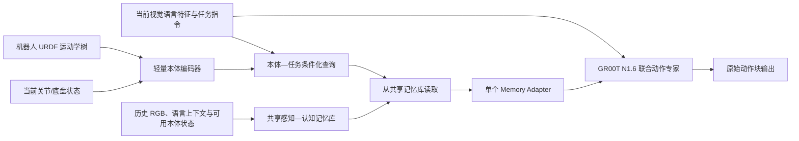

# 面向移动双臂操作的本体结构条件化记忆检索

# Embodiment-Conditioned Memory Retrieval for Mobile Bimanual Manipulation

## 摘要

移动双臂操作涉及底盘运动、躯干构型变化及多执行机构协作。任务目标可能在移动过程中暂时离开视野，当前观测难以完整反映先前看到的物体、位置线索与操作过程。已有记忆增强视觉—语言—动作（Vision-Language-Action，VLA）方法能够保存和读取历史表征，但在给定有限记忆容量时，如何结合当前机器人本体结构与任务需求选择动作相关的历史信息，仍有必要进一步研究。本文提出一种**本体结构条件化记忆检索方法**。方法沿用感知—认知历史记忆的基本思路，复用 VLA 视觉语言骨干的特征构建共享记忆库；利用机器人描述文件中的运动学连接关系及实时本体状态生成结构化本体表征；在此基础上，以任务上下文和不同功能执行组为条件，从同一记忆库检索历史信息，并通过轻量适配器提供给原有联合动作专家。与直接将所有历史特征送入动作网络不同，该方法将本体结构作为历史信息选择的归纳偏置，而不预先将记忆硬划分为底盘、左臂和右臂等独立存储区。所提出的结构不要求构建三维环境地图，也不改变 GR00T N1.6 的联合流匹配动作表示。本文以 BEHAVIOR-1K 2025 为主要实验平台，通过普通记忆检索、状态条件检索及拓扑条件检索之间的逐级比较，考察本体结构是否能够改善移动操作中的历史信息利用，并分析其适用条件与计算代价。

**关键词：**移动双臂操作；视觉—语言—动作模型；历史记忆；机器人本体结构；条件化检索；部分可观测性

## Abstract

Mobile bimanual manipulation requires coordinated base motion, changes in robot configuration, and actions from multiple effectors. Task-relevant objects and interaction context may become temporarily unobservable, making historical information useful for subsequent decisions. Existing memory-augmented vision-language-action (VLA) policies retain historical representations, yet the role of robot embodiment in selecting action-relevant memories under a limited memory budget remains insufficiently understood. We propose an **embodiment-conditioned memory retrieval** approach. The method reuses representations from a pretrained vision-language backbone to maintain a shared perceptual–cognitive history, encodes the robot's kinematic connectivity together with its current proprioceptive state, and generates task- and embodiment-conditioned queries for functional actuation groups. The retrieved memories are integrated into the original joint action expert through a lightweight adapter. Memory is not partitioned into isolated body-part banks, and the method neither requires a reconstructed 3D environment map nor changes the joint flow-matching action representation of GR00T N1.6. We design matched comparisons on BEHAVIOR-1K 2025 to investigate whether embodiment-aware retrieval provides measurable benefits over semantic-only and state-conditioned memory retrieval, and to characterize its limitations and computational costs.

**Keywords:** vision-language-action; mobile bimanual manipulation; historical memory; robot embodiment; retrieval; partial observability

---

## 1 引言

视觉—语言—动作（VLA）模型通过统一表征视觉、语言和机器人状态，为多任务机器人操作提供了新的学习范式。然而，移动双臂机器人与固定桌面机械臂相比，需要同时处理底盘位置变化、上身或升降机构调整以及双臂协作。随着机器人运动，目标物体可能从当前相机视野中消失，先前观察到的物体外观、环境线索及操作进展仍可能影响后续动作。这使移动操作成为典型的部分可观测决策问题。

为缓解历史信息丢失，MemoryVLA [2] 等工作在 VLA 中引入历史记忆，并通过注意力机制读取与当前任务相关的信息。EchoVLA [4]、SOMA [6] 和 SERF [5] 进一步从情节、空间或环境表征等角度研究移动操作中的历史依赖。这些研究说明，记忆内容的保存和读取是解决长时程操作的重要途径。但“存储了有用历史”与“在当前动作中选对有用历史”是两个不同的问题。尤其对于移动双臂机器人，同一段历史观察对底盘返回某个工位、左臂寻找工具、右臂继续装配的价值可能不同。

另一方面，Body Transformer [7] 及相关本体感知策略 [8] 表明，机器人关节之间的连接关系可以作为策略学习的结构先验。已有工作主要关注本体结构如何影响状态与动作表征，而本文进一步考虑：**本体结构能否在动作生成之前，帮助策略判断应当从历史中取回什么信息？** 这不是将关节状态简单拼接进历史记忆，而是让任务上下文、实时构型和运动学拓扑共同参与检索条件的生成。

基于这一问题，本文研究**本体结构条件化记忆检索**。方法保留一个统一的历史记忆库，采用已有 VLA 特征构建视觉与语义历史；另以机器人运动学图及实时关节状态构建本体 Token；最后基于任务与本体状态形成面向不同功能执行组的查询，检索到的结果共同服务原有联合动作专家。本文不要求每个执行组拥有专属记忆库，也不将动作专家拆分为多个彼此独立的网络。

本文围绕以下三方面展开研究：（1）构建与现有 VLA 兼容、无需重新训练独立大型编码器的轻量历史记忆；（2）利用运动学连接关系及实时状态表达移动双臂机器人的本体结构；（3）研究任务与本体结构共同条件化的共享记忆检索，并通过匹配实验检验结构先验的实际作用。本文的核心创新性主张集中在**第三部分及其与前两部分的耦合方式**，而非宣称记忆库、关节 Token 或注意力操作本身首次提出。

## 2 相关工作

### 2.1 VLA 的历史记忆

MemoryVLA [2] 通过感知与认知记忆组织历史信息，使当前策略能够访问过去的视觉细节及语义上下文。MEM [3] 研究多尺度历史组织，为记忆容量与时间跨度之间的权衡提供参考。本文复用“历史特征编码—保存—检索—动作条件化”的技术路线，不把双流记忆作为原创点。不同之处在于：检索查询不仅依赖当前视觉语言表征，还显式受机器人本体结构与运动状态影响。

### 2.2 移动操作的空间与情节记忆

EchoVLA [4] 研究面向移动操作的情节和场景记忆；SOMA [6] 面向目标出视野的空间记忆；SERF [5] 则借助带有空间和时间信息的环境—机器人表征支持长时程操作。本文与这些工作的关系并非“空间信息没有价值”，而是选择研究更轻量的历史表征：不额外重建物体级三维地图，而将已有视觉语言特征及可测机器人状态作为检索依据。该选择是否足够，应由具体任务验证，而不能仅由模型结构推断。

### 2.3 本体结构在机器人策略中的作用

Body Transformer [7] 将机器人的传感器、执行机构及其连接关系表述为图，并使用结构约束的信息交互进行策略学习。形态感知的 Transformer 方法 [8] 进一步将运动学结构及关节属性纳入机器人策略。本文借鉴本体图与关节属性编码的思想，但不直接替换 GR00T 的动作 Token 或动作解码器：本体编码器仅用于**形成记忆查询条件**。因此，本文需要证明的不是“运动学拓扑有用”这一宽泛命题，而是“在相同历史信息与模型预算下，运动学拓扑有助于检索动作相关历史”。

## 3 问题定义与研究动机

### 3.1 部分可观测移动操作与历史记忆

设 \(t\) 表示一次策略决策时刻，\(x_t\) 表示环境与机器人完整但不可直接获得的状态，\(I_t\) 为当前多相机图像，\(s_t\) 为可测本体状态，\(\ell\) 为任务语言指令，\(a_t\) 为待生成的机器人联合动作。当前观测定义为 \(o_t=(I_t,s_t)\)，截至当前的历史为 \(\mathcal H_t=(o_{1:t},a_{1:t-1},\ell)\)。在部分可观测马尔可夫决策过程（Partially Observable Markov Decision Process，POMDP）中，信念状态（belief state）为

\[
b_t(x)=p(x_t=x\mid\mathcal H_t).
\tag{1}
\]

其中，\(b_t(x)\) 表示给定全部可用历史后，当前真实状态为 \(x\) 的后验概率。VLA 通常不直接显式计算式（1），但可以使用容量受限的记忆 \(M_t=f(\mathcal H_{t-1})\) 近似保留对决策有用的历史，其中 \(f\) 为历史编码及管理过程，且不得访问未来观测或动作。于是策略写作

\[
\pi_\theta(a_t\mid I_t,s_t,\ell,M_t),
\tag{2}
\]

其中，\(\pi_\theta\) 为参数为 \(\theta\) 的动作策略。

历史记忆的潜在价值来自当前观测无法完全替代的过去信息。若令 \(A_t^*\) 表示示教数据中当前应执行的动作，则条件互信息

\[
I(A_t^*;M_t\mid I_t,s_t,\ell)
\tag{3}
\]

刻画在已知当前观测与指令后，记忆对示教动作仍含有多少额外预测信息。式（3）不保证任何有限容量网络加入记忆后都能提高闭环成功率；它仅说明应当优先寻找**确实具有历史依赖**的任务，而不是在任何失败任务上都尝试增加记忆。

### 3.2 为什么要让本体结构参与检索

令 \(M_t=\{m_i\}_{i<t}\) 为相同的历史记忆集合。普通语义记忆检索可抽象为

\[
r_t=\operatorname{Retrieve}(q_t^{\mathrm{sem}},M_t),\qquad
q_t^{\mathrm{sem}}=f_q(z_t),
\tag{4}
\]

其中，\(z_t\) 是当前视觉语言上下文，\(q_t^{\mathrm{sem}}\) 是据此生成的语义查询，\(r_t\) 是读取结果。这种查询能够学习语义相关性，但**未显式要求**检索器考虑当前哪些执行机构正在完成任务，以及这些机构通过哪些运动链连接。

对移动双臂而言，当前左臂末端的可达区域依赖其自身关节、上身/升降机构和底盘状态；右臂及相机的观察条件也受到共享运动链影响。因而，即使任务指令及历史库不变，机器人当前构型不同，动作所需历史也可能不同。本文将运动学图 \(G_B\) 与当前本体状态 \(s_t\) 引入查询：

\[
r_t^{B}=\operatorname{Retrieve}\!\left(
f_q(z_t,s_t,G_B),M_t
\right).
\tag{5}
\]

其中，\(G_B\) 为机器人连接结构，\(r_t^B\) 为本体条件化检索结果。式（5）提出一种**可学习的归纳偏置**，并不能从数学上推出 \(r_t^B\) 必然优于式（4）。其合理性与实际价值需要通过控制变量实验加以判断。

### 3.3 研究假设

本文检验两个逐级假设：首先，历史记忆在部分移动操作任务中比仅依赖当前观测更有用；其次，当历史容量、视觉语言输入和训练预算相同时，考虑本体状态及运动学拓扑的检索可在某些任务中比纯语义检索更有效。第二个假设尤其需要与“仅添加关节状态但不使用拓扑”的方法比较，否则无法将增益归因于结构信息。本文不预设该假设在全部任务或全部本体上成立。

## 4 本体结构条件化记忆检索方法

### 4.1 总体架构

本文以 GR00T N1.6 [9,10] 为基础网络，保留其视觉语言骨干、原有联合动作表示及基于流匹配（Flow Matching，FM）的动作专家。新增部分仅包括：历史记忆管理、轻量本体编码器、条件化查询以及一处记忆融合接口。检索在**一次策略决策时刻**计算，随后为当前动作块的流匹配采样提供条件，不在每个采样迭代步重新构建查询。



三个主要研究环节分别为：**记什么、怎样表达本体、依据什么取回记忆**。为避免不必要的模块叠加，记忆容量管理先使用固定窗口和先进先出策略，本体编码先使用小型图网络，记忆融合先采用单层残差适配器。

### 4.2 历史记忆：感知、语义与本体状态元数据

对于历史决策时刻 \(i<t\)，记 \(V_{i,c}\) 为第 \(c\) 个相机经过 GR00T 视觉语言骨干后可提取的视觉特征，\(L_i\) 为相应的视觉语言融合隐藏特征。经轻量投影和压缩得到

\[
p_{i,c}=\mathcal C_P(V_{i,c}),\qquad
c_i=\mathcal C_C(L_i),
\tag{6}
\]

其中，\(\mathcal C_P\) 与 \(\mathcal C_C\) 分别为小型投影/池化模块，\(p_{i,c}\) 是保留相机来源的感知记忆 Token，\(c_i\) 是当前历史时刻的语义记忆 Token。这里借鉴 MemoryVLA [2] 的双类历史表征思想，**不要求重新训练第二套大型视觉编码器**。

令 \(e_i=\mathcal C_S(s_i,a_{i-1},\Delta t_i)\) 为历史本体状态元数据的编码，其中 \(s_i\) 是当时的可测机器人状态，\(a_{i-1}\) 是此前实际执行的动作，\(\Delta t_i\) 为可用时间间隔，\(\mathcal C_S\) 是小型状态投影模块。若某些字段在数据集或推理环境中不存在，相应输入使用有效性掩码，不以仿真真实物体位姿或未公开的任务阶段标签代替。

本文维护一个共享历史记忆库：

\[
M_t=
\left\{
(p_{i,c},e_i,i,c),\ (c_i,e_i,i)
\;\middle|\; i<t
\right\}.
\tag{7}
\]

式（7）中，\(i\) 为历史索引，\(c\) 为相机索引。感知记忆与语义记忆可以在实现上使用两个缓冲区，但它们**不是按底盘、左臂、右臂分割的独立记忆库**；所有查询均可访问相同历史。历史本体状态首先作为每条记忆的上下文元数据，不额外引入复杂的第三套记忆写入/遗忘系统。内存容量固定，按时间截取最近的 \(K\) 个有效历史决策时刻；\(K\) 是记忆长度超参数。

这一设计保留未来扩展空间，但论文的第一版只需回答：在合理容量内，普通历史记忆是否确实帮助 GR00T 完成具有历史依赖的移动任务。

### 4.3 本体结构：从 URDF 到运动学 Token

机器人本体表示为运动学图

\[
G_B=(\mathcal V_B,\mathcal E_B),
\tag{8}
\]

其中，\(\mathcal V_B\) 为由机器人描述文件（Unified Robot Description Format，URDF）和控制接口确定的关节、关键刚体或功能节点集合，\(\mathcal E_B\) 为其运动学连接边。底盘、升降机构、躯干、双臂和头部相机等依照实际机器人结构连接，**不强制假设所有机器人都具有相同的四个固定部件**。

对关节节点 \(j\in\mathcal V_B\)，将静态属性 \(u_j\)（例如关节类型、关节轴、运动学连接及必要的关节限位）与当前可测运动状态 \(x_{j,t}\)（例如关节角 \(q_{j,t}\)、可用的关节速度 \(\dot q_{j,t}\)）编码为

\[
b_{j,t}^{(0)}
=\operatorname{MLP}\!\left(
\left[\operatorname{Enc}_{\mathrm{attr}}(u_j);
\operatorname{Enc}_{\mathrm{state}}(x_{j,t})\right]
\right).
\tag{9}
\]

其中，\([\,;\,]\) 表示特征拼接，\(\operatorname{Enc}_{\mathrm{attr}}\) 与 \(\operatorname{Enc}_{\mathrm{state}}\) 分别编码静态运动学属性和动态状态。无速度信息时仅使用位置及有效性标记。必要的正向运动学（Forward Kinematics，FK）结果可作为节点特征的补充，但**不把历史相机到当前末端的精确空间对齐设为整个方法的前提**。

为了表达关节之间的依赖，采用 \(L_B\) 层轻量拓扑约束注意力：

\[
B_t=\operatorname{GraphAttn}
\left(\{b_{j,t}^{(0)}\}_{j\in\mathcal V_B},
\mathcal E_B\right),
\tag{10}
\]

其中，\(B_t=\{b_{j,t}\}\) 为更新后的本体 Token 集合，\(L_B\) 是较小的层数。注意力仅在指定邻接或祖先路径上交换信息，具体掩码规则对所有实验固定。该设计借鉴 Body Transformer 的运动学归纳偏置，不复制其动作输出结构。

以左臂为例，其上游路径可以包含底盘、升降机构、躯干及左臂各关节。通过这些路径的特征聚合，左臂查询能够获得自身及上游机构的状态，而不是只看到左臂关节角。另保留全局本体特征，避免各执行组在检索时失去协作所需的共享信息。

### 4.4 本体、任务与动作需求共同条件化检索

令 \(z_t=\operatorname{Pool}(H_t^{VL})\) 为当前视觉语言骨干提供的任务上下文。定义功能执行组集合 \(\mathcal G\)，每个执行组对应动作接口中的一个可辨识功能子集，例如底盘运动、左臂或右臂操作。执行组仅用于组织**查询视角**，不意味着动作网络被拆分为多套专家；组与关节的关联由 URDF 和动作维度配置共同给出。

对组 \(g\in\mathcal G\)，记 \(\mathcal P(g)\) 为与该组运动相关的关节/功能节点集合，包含该组及必要的上游运动链。定义组级与全局本体特征：

\[
\bar b_{g,t}=\operatorname{Pool}_{j\in\mathcal P(g)} b_{j,t},
\qquad
\bar b_t=\operatorname{Pool}_{j\in\mathcal V_B} b_{j,t}.
\tag{11}
\]

令 \(e_g\) 为功能执行组的编码，\(\bar a_{t-1}^{(g)}\) 为上一个决策周期已经执行、且归属于该组的动作摘要（可选输入，缺失时省略）。查询为

\[
q_{g,t}=W_Q\!\left[
z_t;\bar b_{g,t};\bar b_t;e_g;
\operatorname{Enc}_a(\bar a_{t-1}^{(g)})
\right].
\tag{12}
\]

其中，\(W_Q\) 为可学习投影，\(\operatorname{Enc}_a\) 为轻量历史动作编码器。**式（12）中的动作需求并非通过读取未来真实动作获得**：当前任务语义、执行组身份、当前运动状态以及已执行动作共同提供可用的控制上下文。最小实现可先去掉最后一项，验证纯“任务 + 本体结构”查询；只有当已有动作历史确实提供增益时才保留它。

感知记忆和语义记忆使用同一个组查询，从共享历史中分别读取信息。例如，对感知记忆条目 \(p_{i,c}\)，令 \(k_{i,c}=W_K[p_{i,c};e_i]\) 为记忆键，\(v_{i,c}=W_Vp_{i,c}\) 为记忆值，定义

\[
\alpha_{g,i,c,t}
=\operatorname{Softmax}_{(i,c)}
\left(\frac{q_{g,t}^{\top}k_{i,c}}{\sqrt d}\right),
\qquad
r^P_{g,t}=\sum_{i,c}\alpha_{g,i,c,t}v_{i,c},
\tag{13}
\]

其中，\(W_K,W_V\) 为投影矩阵，\(d\) 为查询和键的维数，\(\alpha_{g,i,c,t}\) 为组 \(g\) 对历史图像条目的读取权重，\(r^P_{g,t}\) 为感知历史读取结果。语义历史 \(c_i\) 采用对应的键、值投影及相同形式的注意力，得到 \(r^C_{g,t}\)。每个功能执行组得到历史条件

\[
r_{g,t}=[r^P_{g,t};r^C_{g,t}],
\qquad
R_t=\operatorname{Concat}\bigl(
\{r_{g,t}\}_{g\in\mathcal G},r_{\mathrm{global},t}
\bigr),
\tag{14}
\]

其中，\(r_{\mathrm{global},t}\) 为可选的、使用全局本体与任务上下文生成的统一查询输出，\(\operatorname{Concat}\) 表示沿 Token 维连接。保留全局查询可使动作专家同时访问任务级共享历史与组级历史；其必要性在实验中通过关闭该分支检验。

式（12）—（14）是本文区别于普通记忆读取的核心：**相同历史库、相同历史图像，不同的当前任务、本体构型与功能执行需求，可以产生不同的读取权重。** 这里没有人为规定“左臂只能读取左臂历史”。各组共享全部历史，仅查询条件不同，从而允许跨部件利用信息。

### 4.5 与 GR00T N1.6 联合动作专家融合

记 \(H_{t,\lambda}^{(k)}\) 为 GR00T 在流匹配时间 \(\lambda\) 下第 \(k\) 层动作专家的隐藏表示，\(R_t\) 为式（14）的历史 Token。本文在一个选定的动作专家层引入共享记忆适配器：

\[
\widetilde H_{t,\lambda}^{(k)}
=H_{t,\lambda}^{(k)}
+\gamma\operatorname{CrossAttn}
\left(H_{t,\lambda}^{(k)},W_RR_t,W_RR_t\right),
\tag{15}
\]

其中，\(\operatorname{CrossAttn}\) 为交叉注意力，\(W_R\) 为记忆投影，\(\gamma\) 为可学习残差系数，\(\widetilde H_{t,\lambda}^{(k)}\) 为融合后的动作特征。初始残差可设为零以便检查与原模型一致性。具体接入层必须以锁定的 GR00T N1.6 代码为准，而不是假设所有版本具有相同接口。

所有功能组的检索结果共同送入**原来的联合动作专家**，不额外创建底盘专家、左臂专家或右臂专家；原有动作维度、动作块长度、归一化及解码过程不改变。一次策略决策中，\(R_t\) 可在流匹配数值积分期间缓存，避免每一步重新运行图编码与历史检索。

### 4.6 训练目标与端到端优化

设 \(A_t^*\in\mathbb R^{H\times D}\) 为示教动作块，\(H\) 为动作时间长度，\(D\) 为联合动作维数，\(\varepsilon\) 为同形状的高斯噪声。设 \(\lambda\in[0,1]\) 为流匹配插值时间。以使用线性插值的 GR00T N1.6 实现为例，

\[
A_t^\lambda=(1-\lambda)\varepsilon+\lambda A_t^*,
\qquad
U_t^*=A_t^*-\varepsilon,
\tag{16}
\]

其中，\(A_t^\lambda\) 为插值动作，\(U_t^*\) 为目标速度。令 \(v_\theta\) 为包含新增模块的速度预测网络，\(\Omega_t\) 为有效动作维度掩码，损失为

\[
\mathcal L_{\mathrm{FM}}=
\mathbb E\left[
\frac{\left\|
\Omega_t\odot
\left(v_\theta(A_t^\lambda,\lambda\mid I_t,s_t,\ell,M_t)-U_t^*\right)
\right\|_F^2}
{\sum_{h,d}\Omega_{t,h,d}+\epsilon}
\right],
\tag{17}
\]

其中，\(\odot\) 为逐元素乘法，\(\|\cdot\|_F\) 为 Frobenius 范数，\(\epsilon>0\) 为数值稳定项。具体噪声采样分布和损失归一化应与锁定基座代码保持一致；式（16）—（17）表达训练关系，**不是另行提出的训练算法**。

训练阶段可先冻结主体并训练投影、图编码、检索与适配器，再按与基线一致的策略微调必要的原模型层。历史窗口只包含当前时刻之前的数据；训练与评测都不从未来轨迹、未来动作或真值任务阶段构造查询。训练时保证每个样本的历史属于同一 episode，推理时按 episode 清空缓存。

## 5 实验设计

### 5.1 实验平台与研究对象

主要采用 BEHAVIOR-1K 2025（B1K-2025）任务与兼容的 GR00T N1.6 权重 [10–12]。优先选择当前代码已经能够稳定进行闭环推理、且示教轨迹确实包含历史依赖的移动操作任务。任务筛选依据应包括：目标临时出视野、跨区域移动后继续操作、重复物体干扰、底盘与双臂任务切换等，而非单纯按照任务名称决定。

按照官方评测输入约束，模型只使用允许的 RGB、可测本体状态、指令及已有动作历史。不能直接将仿真器物体真实位姿、隐藏任务完成阶段或机器人特权全局位姿送入记忆与查询。训练和推理应核对相机、关节、底盘状态及时间序列在数据接口中是否真实可得；若某种状态不能获得，应删除对应特征，而不是依赖特权数据进行论文评测。

### 5.2 关键对照与消融

所有带记忆模型使用**相同历史帧、相同记忆容量、相同融合接口与相同动作专家**；额外状态输入及训练参数量尽可能匹配。建议按以下顺序开展实验：

| 模型 | 记忆与检索方式 | 主要回答的问题 |
|---|---|---|
| B0 | 原始 GR00T N1.6 | 不使用历史时的基础性能 |
| M1 | 统一视觉—语义历史记忆，纯语义查询 | 加入历史是否有用 |
| M2 | M1 + 当前本体数值状态条件，无拓扑编码 | 收益是否仅来自增加关节/底盘状态 |
| M3 | M2 + URDF 拓扑编码及组级查询（本文） | 机器人结构是否带来额外收益 |
| M3-shuffle | 与 M3 相同，但打乱/替换拓扑连接 | 改善是否依赖正确的运动学结构 |

其中，**M3 对 M2** 才是检验“本体结构是否有用”的主要比较，而 **M3 对 M1** 只能检验更宽泛的“结构与状态条件化是否有用”。为避免把“多个查询更有效”误当成拓扑贡献，增加一个与 M3 查询数量相同、但不使用运动学图的 M2-multi 对照即可；无需预先扩张为十余种模型。

补充实验可考察：不同记忆长度 \(K\)、是否保留全局查询、是否使用已执行动作历史，以及不同本体构型区间的结果。这些均为次要分析；优先完成 B0—M3 的逐级验证。

### 5.3 评价指标与统计

主要评价采用官方定义的闭环任务成功率和任务进度分数，并将二者分别报告。对具有历史依赖的任务，补充统计目标再次出现后能否正确恢复操作、重复物体误选择次数、任务切换后的恢复情况等**可以从已有评测状态或少量轨迹标注中可靠获得**的指标，不必为此额外开发庞大的新 Benchmark。

每项任务可先进行约 10 次 rollout 作为调试与方差估计，再根据实际成功率、波动和预期效果确定正式评估样本量。尽可能使用相同测试实例和随机配置开展成对比较，报告任务级分布、置信区间、训练随机种子，以及额外推理时间、显存与参数量。少量成功率差异不能直接当作统计上可靠的创新证据。

### 5.4 研究假设的判定

如果 M1 与 B0 没有差别，应首先检查所选任务是否真正需要历史，记忆读取是否实际被利用；不能直接断定本体结构方案失败。如果 M2 优于 M1 而 M3 没有进一步提高，说明当前收益更可能来自本体状态，而非显式运动学拓扑。如果 M3 对 M2 和 M2-multi 均有稳定收益，且错误拓扑使性能下降，才有较强证据支持本文的核心机制。若效果只出现在少数任务，应分析这些任务共同具有何种历史依赖，而不是宣称普遍优于所有 VLA 方法。

## 6 讨论与局限

本体图提供的是机器人结构先验，并不等同于环境物体的空间地图。历史视觉表征可能保存目标外观或交互线索，但只依靠关节拓扑无法推导目标物体在世界中的精确位置，也不能自动解决动态物体跟踪与精密接触控制。因此，本文关注记忆的**选择与利用**，而非取代定位、感知或底层控制。

尽管对功能执行组构造不同查询，本文仍保留共享记忆库与联合动作专家，以避免固定划分造成双臂、底盘与躯干之间的信息隔离。此外，结构化查询不是性能保证：足够强的普通注意力也可能从数据中学习本体依赖；当数据充足、任务简单或本体结构几乎不变化时，额外运动学偏置未必带来收益。跨机器人少样本适应是值得研究的后续问题，但必须在多个具有不同运动结构的真实或仿真本体上验证，不能由本体编码器可接受不同 URDF 就直接推出。

## 7 结论

本文研究移动双臂 VLA 在有限历史记忆下的动作相关信息检索问题，提出一种利用当前任务上下文、实时本体状态及运动学拓扑生成历史查询的方法。与重建环境地图或重构整个动作模型不同，本文在共享感知—认知记忆与原有联合动作专家之间增加轻量的本体条件化读取机制。所设计的逐级对照能够区分历史记忆、本体状态与运动学结构各自的贡献，为判断本体结构是否以及在何种条件下有助于移动操作提供实验依据。

## 参考文献

[1] Kaelbling L P, Littman M L, Cassandra A R. Planning and acting in partially observable stochastic domains. *Artificial Intelligence*, 1998, 101(1–2): 99–134. https://doi.org/10.1016/S0004-3702(98)00023-X.

[2] Shi H, Xie B, Liu Y, et al. MemoryVLA: Perceptual-Cognitive Memory in Vision-Language-Action Models for Robotic Manipulation. *ICLR*, 2026. https://arxiv.org/abs/2508.19236.

[3] MEM: Multi-Scale Embodied Memory for Vision-Language-Action Models. arXiv:2603.03596, 2026. https://arxiv.org/abs/2603.03596.

[4] Lin M, Liang X, Lin B, et al. EchoVLA: Robotic Vision-Language-Action Model with Synergistic Declarative Memory for Mobile Manipulation. arXiv:2511.18112, 2025. https://arxiv.org/abs/2511.18112.

[5] Kim S, Pak B, Long K, Tian Y, Atanasov N. SERF: Spatiotemporal Environment and Robot Feature Map for Long-Horizon Mobile Manipulation. arXiv:2606.12956, 2026. https://arxiv.org/abs/2606.12956.

[6] Li P, Guo W, Zhang H, et al. Spatial Memory for Out-of-Vision Manipulation in Vision-Language-Action. arXiv:2605.22283, 2026. https://arxiv.org/abs/2605.22283.

[7] Sferrazza C, Huang D M, Liu F, Lee J, Abbeel P. Body Transformer: Leveraging Robot Embodiment for Policy Learning. *Proceedings of the 8th Conference on Robot Learning*, PMLR 270:3407–3424, 2025. https://proceedings.mlr.press/v270/sferrazza25a.html.

[8] Suzuki K, Liu J, Wang Y, et al. Embedding Morphology into Transformers for Cross-Robot Policy Learning. arXiv:2603.00182, 2026. https://arxiv.org/abs/2603.00182.

[9] NVIDIA GEAR Team. GR00T N1.6: An Improved Open Foundation Model for Generalist Humanoid Robots, 2025. https://research.nvidia.com/labs/gear/gr00t-n1_6/.

[10] NVIDIA. GR00T N1.6 BEHAVIOR1k model card and Isaac-GR00T `n1d6` source. https://huggingface.co/nvidia/GR00T-N1.6-BEHAVIOR1k ; https://github.com/NVIDIA/Isaac-GR00T/tree/n1d6.

[11] Li C, Zhang R, Wong J, et al. BEHAVIOR-1K: A Human-Centered, Embodied AI Benchmark with 1,000 Everyday Activities and Realistic Simulation. arXiv:2403.09227, 2024. https://arxiv.org/abs/2403.09227.

[12] BEHAVIOR-1K Challenge 2025. Evaluation Rules and Dataset Documentation. https://behavior.stanford.edu/challenge/archive/2025/evaluation.html ; https://behavior.stanford.edu/challenge/archive/2025/dataset.html.

---

# 补充材料：研究路线、技术实施与版本修订说明（不属于论文正文）

## A. 本版恢复的主线

本版依据此前讨论的方向恢复为“**GR00T N1.6 + MemoryVLA 式历史记忆 + Body Transformer 启发的本体结构编码 + 本体/任务条件检索**”。

与 2026-11-08 的 KFMR 版本相比，主要恢复与删改如下：

| 研究要点 | 本版保留/恢复 | 从核心方法移出的内容 |
|---|---|---|
| 研究问题 | 本体结构如何改变动作相关的历史记忆选择 | 将历史相机与当前末端的精确参考系对齐作为唯一主问题 |
| Memory | 共享感知—认知历史与可测本体元数据 | 额外设计独立的复杂记忆写入/遗忘机制 |
| Body | URDF 运动学图、关节属性、实时状态和拓扑信息传播 | 只有相机/末端的 FK 变换、完全取消逐关节结构 |
| Retrieval | 任务 + 本体 + 功能执行组共同生成 Query | 单独的几何可靠性预测网络与多重几何检索分支 |
| Action | 保留原始 GR00T 联合动作与 FM 损失 | 新增多套独立动作专家、强制重排关节动作 Token |
| 论文论证 | 数学说明动机 + 控制变量实验验证假设 | 将“必然优于普通检索”作为未经证明的理论结论 |

说明：本版不是对最早某一文件的逐字回滚，而是根据原始研究主线，保留当前版本中仍合理的学术写法与实验约束，重新组织的工作稿。

## B. 最小可实施代码架构

以已经能够运行的 GR00T N1.6 × B1K-2025 训练、推理和评测工程为起点，建议增加以下逻辑模块（文件名为建议，不对应已核对的上游实际目录）：

```text
project/
├── data/
│   ├── episode_history.py       # 历史窗口采样；只取同一 episode 的过去帧
│   └── observation_adapter.py   # GR00T 输入转换与有效性掩码
├── memory/
│   ├── bank.py                  # 固定长度共享记忆、重置及更新
│   ├── encoder.py               # 复用 VLM 特征 + 小型 P/C 投影
│   └── retrieval.py             # 统一检索与本体条件检索共用接口
├── embodiment/
│   ├── urdf_graph.py            # 关节图与功能执行组映射
│   ├── body_encoder.py          # 关节属性/状态 Token 与轻量 GraphAttn
│   └── query.py                 # task/body/group → Query
├── model/
│   └── memory_adapter.py        # 单处注入原动作专家
└── evaluation/
    ├── protocol.py              # 固定任务、场景、seed、horizon
    └── compare.py               # B0/M1/M2/M3 与匹配统计
```

**关键实现约束：**先确认 B1K 数据中能按时间连续恢复历史观测、相机身份、状态和动作；再检查 GR00T N1.6 锁定分支 VLM 特征与动作专家的实际张量接口。不得将“论文示意结构”未经核对就当作源代码中的现成调用点。

## C. 分阶段实验实施

**阶段 0：固定基线。** 固定 B1K-2025 版本、N1.6 权重及 `n1d6` 代码、动作归一化、episode 截止与评测脚本，记录每任务的成功率、任务进度、rollout 用时和失败类别。此阶段只要基线稳定且输入可审计，不需先搭建新的场景。

**阶段 1：最小历史记忆 M1。** 将当前 VLM 中可获取的特征保存为有限历史；在动作专家接入单个记忆 Adapter。先验证 `memory=off` 时模型与原始基线数值一致，再测试历史是否改善一类明确的遮挡/移出视野任务。如果 M1 不工作，先排查时间窗口、历史内容和训练信号。

**阶段 2：本体状态查询 M2。** 在不改变记忆库、检索 Token 数量和动作专家的前提下，仅将当前关节/底盘状态加入查询，与 M1 比较。此阶段单独回答“机器人本体状态是否有价值”，避免立即引入复杂的图网络。

**阶段 3：拓扑条件查询 M3。** 从 URDF 获得关节图；编码关节类型、轴、连接关系及动态关节状态；根据功能执行组与其上游运动链聚合 Token，形成查询。关键比较是 M3 对 M2 及 M2-multi。若无明显增益，先检查任务是否真的需要本体结构，而非立即叠加新的门控、记忆预算分配器或几何网络。

**阶段 4：扩展验证。** 当 M3 的结构贡献成立后，再扩展更多 B1K 任务与真实机器人；若要主张跨本体泛化，须提供至少两个结构不同的本体及可比的训练数据/样本量，而不是只凭 URDF 接口兼容。

## D. 论文创新性与科学问题的边界

1. **能够从理论说明的：** POMDP 下当前观测可能不足，历史可以补充决策信息；机器人运动学连接关系是客观存在的结构信息；图结构可作为学习中的归纳偏置。
2. **不能预先证明的：** 对同一数据集，拓扑查询一定优于语义查询；加入记忆一定减少训练数据；一个本体训练出的结构查询一定能快速迁移到新机器人。
3. **最重要的论文证据：** 相同历史和参数预算下 M3 优于 M2/M2-multi；随机或错误拓扑削弱效果；提升主要发生在具有清晰历史依赖及多执行机构状态差异的任务。
4. **明确不作为核心创新的：** 感知—认知双流记忆、URDF 解析、GraphAttn 算子、Cross-Attention 算子、GR00T 的原始 FM 损失。

## E. 暂不加入主模型的候选方向

- **显式历史相机—执行器参考系对齐：** 如后续发现仅靠本体编码无法利用跨视角历史，可作为独立对照或扩展，而不是当前必选主线。
- **中间动作隐藏状态驱动的动态 Query：** 需先确认静态任务/本体查询的瓶颈，并核对 GR00T 动作专家中可安全复用的隐藏状态；初版避免每个流匹配采样步重复检索。
- **可学习的记忆容量分配器、复杂可靠性门控、多专家路由：** 未有直接实验需求前不引入。
- **环境空间地图或物体级记忆：** 只有当不建图记忆在特定任务中显示明确不足时再考虑，不为了显得创新而增加。

## F. 投稿前的必要核查

- [ ] 核对文中 MemoryVLA、MEM、EchoVLA、SERF、SOMA 等引用的正式作者、版本、具体机制；不要只凭名称判断差异。
- [ ] 核对锁定的 N1.6 `n1d6` 权重、主干输出、动作专家接口、实际 FM 损失与动作维度。
- [ ] 核对 B1K-2025 训练数据和评测 wrapper 中可用的时间序列、关节与底盘状态，杜绝使用特权输入。
- [ ] 用实际闭环实验完成至少 B0、M1、M2、M2-multi、M3 及错误拓扑对照。
- [ ] 在形成投稿版摘要、实验结果和结论前补入真实统计结果；本稿未声称已获得任何实验性能提升。
