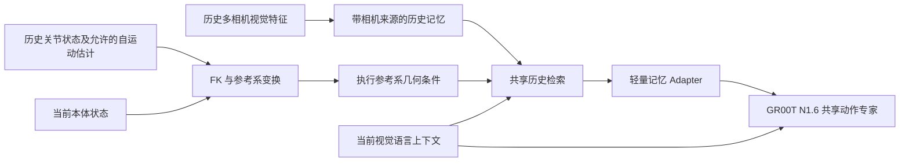

# 面向移动双臂操作的执行参考系对齐记忆检索

# Kinematic-Frame-Aligned Memory Retrieval for Mobile Bimanual Manipulation

> **稿件状态：方法重构稿（2026-11-08）。** 本文尚无 ECMR 实验结果；摘要、实验与结论中的方括号为必须由实测结果替换的投稿占位符。本稿不将理论性质误写为性能保证。正式投稿前需删除本提示及参考文献后的研究备注。

## 摘要

移动双臂机器人在跨工位任务中不断改变底盘、相机与执行机构之间的相对构型，使历史观测既可能包含当前不可见的目标信息，也可能由于观察参考系变化而难以直接用于动作决策。现有记忆增强视觉—语言—动作（Vision-Language-Action，VLA）策略通常依据当前视觉语言特征检索历史表征；然而，在移动操作中，历史图像的语义相关性与其相对于当前执行机构的观察条件并不等价。为研究这一差异，本文提出**执行参考系对齐记忆检索**（Kinematic-Frame-Aligned Memory Retrieval，KFMR）。方法为历史相机视觉特征保存可追踪的观察来源；利用机器人正向运动学与允许使用的自运动估计，将历史相机参考系表达为相对于当前底盘或末端执行器的变换；再以该相对变换作为检索打分的几何条件，由任务上下文选择历史证据。对于运动估计不可靠的记录，可靠性门控降低几何项的作用，使检索退化为语义记忆读取。该方法保留共享历史库和 GR00T N1.6 的联合流匹配动作专家，不构建物体级三维地图，也不将动作 Token 改写为关节 Token。本文设计针对记忆内容、相对底盘运动、执行参考系对齐及几何可靠性的匹配对照，在 BEHAVIOR-1K 2025 移动操作任务上检验所提出的归纳偏置是否提高历史信息的决策利用效率。**[投稿前补入实验任务、样本量、主指标增益与置信区间；若实验不支持核心假设，须调整方法主张。]**

**关键词：**移动双臂操作；视觉—语言—动作模型；历史记忆；运动学参考系；条件化检索；部分可观测性

## Abstract

Mobile bimanual manipulation changes the relative configurations of the robot base, cameras, and end effectors as the robot moves between workstations. Consequently, past observations may contain currently invisible task evidence, while their original observation frames differ from the frames in which actions are generated. Existing memory-augmented vision-language-action (VLA) policies commonly retrieve historical features based on current visual-language context, without necessarily distinguishing semantic relevance from the observation geometry of past evidence. We propose **Kinematic-Frame-Aligned Memory Retrieval (KFMR)**. The method retains the provenance of historical camera features, uses forward kinematics and permissible ego-motion estimates to express each historical camera frame relative to the current base or end-effector frame, and conditions memory retrieval scores on these relative transforms. A reliability gate suppresses geometric conditioning when motion estimates are uncertain, reducing retrieval to its semantic component. KFMR uses a shared memory bank and conditions the joint flow-matching action expert of GR00T N1.6 without building an object-level 3D map or restructuring action tokens into joints. Controlled comparisons on BEHAVIOR-1K 2025 evaluate the contributions of temporal memory, relative base motion, effector-frame alignment, and geometric reliability under matched observation and computational budgets. **[Insert measured task results and statistical evidence before submission.]**

**Keywords:** vision-language-action; mobile bimanual manipulation; episodic memory; kinematic reference frames; retrieval; partial observability

---

## 1 引言

视觉—语言—动作模型将视觉观测、语言目标与机器人状态映射到连续控制动作，在多任务操作中展现出良好的策略表示能力。然而，在移动双臂任务中，机器人需要反复改变其与货架、工作台和目标物体之间的位置关系；任务相关物体可能暂时离开视野，历史画面也可能因相机随底盘、升降机构和手臂运动而不再与当前动作参考系直接对应。此时，即使历史视觉表征包含有效线索，策略仍需判断该线索是在何种观察条件下获得、与当前哪些动作参考系有关。

记忆增强 VLA 为部分可观测操作提供了历史信息保留机制。MemoryVLA [2] 维护感知与认知记忆，并以当前工作表征检索历史特征；EchoVLA [4] 通过场景与情节记忆支持移动操作；SOMA [6] 建立出视野目标的空间记忆；SERF [5] 则利用时空神经点及多参考系特征服务长时程移动操作。这些方法表明，历史信息的时序组织及空间背景会影响策略表现。不过，构建精细三维环境状态并非每个移动操作任务的前提：当策略主要需要恢复曾经观察到的外观、地点线索或交互上下文时，有必要首先检验是否能利用更轻量的历史来源信息改善检索。

本文关注一种可操作、可证伪的中间问题：**在相同历史视觉信息和本体状态输入下，显式将历史观察条件对齐到当前动作执行参考系，是否比仅依赖任务语义或底盘相对运动的记忆检索更有效？** 该问题不同于泛泛地“将本体信息加入 VLA”。机器人运动学在本文中不只形成附加 Token，而是用于计算历史相机与当前执行机构之间具有明确几何含义的相对变换。对于同一历史视觉特征，底盘重定位与左、右臂操作所对应的参考系不同，因此其观察来源的几何条件也不同；各执行组仍从同一个历史库中读取证据，不强制规定不同部件使用相互隔离的记忆。

据此，本文提出 KFMR。历史视觉特征附带采集时间、相机身份及相应的机器人运动状态；由运动学模型和自运动估计建立从历史相机到当前功能执行参考系的变换；检索器在语义相似性上加入可靠性调制的相对几何打分，并将读取结果送入 GR00T N1.6 的共享动作专家。与以机器人拓扑偏置为核心的 Body Transformer [7]、BodyVLA [8] 不同，本文不以关节级信息传播或跨本体动作分解为主要贡献；与 SERF [5] 不同，本文不维护物体或环境神经点地图，而研究历史**观测证据**在当前执行参考系下的选择。

本文的**待验证贡献**是：（1）定义无需环境三维重建、但对历史相机来源保持可追踪性的执行参考系对齐记忆读取机制；（2）通过可靠性门控，在运动学信息可用时提供结构化检索条件，在运动估计失效时保留纯语义检索通道；（3）提出能够区分“历史有用”“底盘运动有用”与“执行参考系对齐有用”的公平对照协议。这里不将双流记忆、正向运动学、交叉注意力或流匹配本身列为原创算法。

## 2 相关工作

### 2.1 VLA 的历史记忆

MemoryVLA [2] 将视觉细节与语义表征分别保留在感知—认知记忆中，通过记忆检索、融合与容量管理支持长时程操作。MEM [3] 则研究多尺度历史组织。这类研究为历史信息的保存和读取提供基础，但记忆条目的视觉来源不必然具有能够服务移动执行参考系的几何描述。本文使用已有的历史特征存储思路，而将研究重点放在**如何为历史相机观察建立可解释的动作参考系条件**。因此，单纯复现感知—认知双流记忆不构成本文的新增方法。

### 2.2 移动操作中的空间与情节信息

EchoVLA [4] 使用场景与情节记忆，通过注意力为移动操作策略提供历史上下文。SOMA [6] 借助主动视角获取并维护空间—语义信息，以处理出视野目标。SERF [5] 在环境与机器人共享表征中利用多参考系几何信息。上述工作与本文的研究问题高度相关，尤其说明“多参考系信息”本身并非新概念。本文关注的是更窄的设置：保留历史相机视觉证据及其观察来源，不估计物体三维状态，不维护环境点云或神经点地图，而直接研究历史相机相对于**当前执行机构**的相对位姿能否改善证据选择。该区别是表征和使用方式上的区别，不能在缺少实验时声称具有普遍优越性。

### 2.3 本体运动学结构与动作表示

Body Transformer [7] 和 BodyVLA [8] 表明，机器人关节拓扑及属性可作为策略学习的结构先验。本文不复制其拓扑注意力网络，也不改造 GR00T 的动作 Token 布局；运动学树在这里主要用于确定相机、底盘及末端执行器之间的刚体关系。机器人结构进入检索的方式是显式坐标变换，而不是在普通查询向量中拼接一个结构编码。不同本体下的可用性属于潜在拓展，需要额外训练与测试，不能由数学表示兼容性直接推出跨本体泛化能力。

## 3 问题定义与方法动机

### 3.1 历史记忆的决策价值

令 $t$ 表示策略的一次决策时刻；$x_t$ 为包含物体、环境和机器人状态的真实隐变量；$I_t$ 为同步多相机图像；$s_t$ 为当前可测本体状态；$a_t$ 为机器人联合动作；$\ell$ 为任务语言指令。观察为 $o_t=(I_t,s_t)$，历史为 $\mathcal H_t=(o_{1:t},a_{1:t-1},\ell)$。在部分可观测马尔可夫决策过程（Partially Observable Markov Decision Process，POMDP）中，信念状态定义为

$$
b_t(x)=p(x_t=x\mid\mathcal H_t).
\tag{1}
$$

记忆 $M_t=f(o_{1:t-1},a_{1:t-1})$ 是对历史的容量受限压缩；其中 $f$ 为历史编码和维护过程，$M_t$ 不包含当前决策之后的信息。本文不要求 $M_t$ 精确重建 $b_t$，而是希望它对动作策略 $\pi(a_t\mid o_t,\ell,M_t)$ 提供有用条件。保留历史并不保证改进性能：只有当记忆包含当前观察所缺少、且可被策略利用的信息时，闭环任务表现才可能提高。

### 3.2 同一历史视觉证据具有不同的执行参考系

用 ${}^{A}T_B\in SE(3)$ 表示坐标系 $B$ 相对于坐标系 $A$ 的刚体变换；$SE(3)$ 是三维刚体运动群。机器人以 $B_t$ 表示当前底盘坐标系，以 $C_{i,c}$ 表示历史时刻 $i$ 的第 $c$ 个相机坐标系，以 $E_{g,t}$ 表示当前功能执行组 $g$ 的参考系（例如底盘或左、右末端）。令 $q_i$、$q_t$ 分别为历史及当前可测关节位置；由机器人描述文件和正向运动学（Forward Kinematics，FK）可计算 ${}^{B_i}T_{C_{i,c}}(q_i)$ 与 ${}^{B_t}T_{E_{g,t}}(q_t)$。

另令 $O$ 为任意选定的**局部里程计参考系**，${}^{O}\widehat T_{B_i}$ 为使用允许的自运动信号得到的底盘相对位姿估计；帽号 $\widehat{\cdot}$ 表示估计而非仿真真值。历史相机相对于当前执行参考系的变换定义为

$$
{}^{E_{g,t}}\widehat T_{C_{i,c}}=
\left({}^{O}\widehat T_{B_t}\,{}^{B_t}T_{E_{g,t}}(q_t)\right)^{-1}
\left({}^{O}\widehat T_{B_i}\,{}^{B_i}T_{C_{i,c}}(q_i)\right).
\tag{2}
$$

式（2）将**底盘移动、历史相机姿态与当前执行机构构型**置于同一几何关系中。对底盘组取 ${}^{B_t}T_{E_{g,t}}=I_4$，其中 $I_4$ 为四阶单位矩阵；对机械臂取对应末端的正向运动学变换。若使用不同局部里程计系 $O'$，且所有相应位姿统一左乘同一刚体变换 $S$，则有

$$
\left(S\,{}^{O}\widehat T_{E_{g,t}}\right)^{-1}
\left(S\,{}^{O}\widehat T_{C_{i,c}}\right)
={}^{E_{g,t}}\widehat T_{C_{i,c}}.
\tag{3}
$$

这里 ${}^{O}\widehat T_{E_{g,t}}$ 与 ${}^{O}\widehat T_{C_{i,c}}$ 是式（2）两侧括号内的复合变换，$S$ 为任意公共坐标系改变。式（3）只说明相对变换对**公共坐标系重新定义不敏感**；它不能证明检索准确率或动作成功率会提高。尤其重要的是，式（2）提供的是**历史相机在哪里、从什么姿态观察**，并不提供相机画面中某个物体的三维位置，也不等价于地图或物体跟踪。

### 3.3 可检验假设

本文的主假设为：当任务要求策略从不同历史观察视角恢复有用证据，且运动估计具有足够可靠性时，在相同视觉记忆和本体状态预算下，按执行参考系条件化的检索可比未对齐的语义检索更有效地选择历史信息。该假设仅对具有相应历史依赖的任务可能成立；若机器人结构固定、视觉信息已充分、历史相机几何与当前决策无关，或自运动估计漂移严重，显式对齐不一定带来增益。

## 4 方法

### 4.1 总体结构

KFMR 包含三个实现环节：历史观察来源的记录、执行参考系对齐的检索、共享动作专家的轻量融合。历史库仅提供**之前**的观测证据；当前视觉与语言特征仍由 GR00T N1.6 的视觉语言骨干产生。所提出的检索不改变基础模型的联合动作表示和流匹配训练目标，也不在每个动作去噪步重复更新记忆。

### 4.2 保留观察来源的历史记忆

对历史决策时刻 $i<t$ 的第 $c$ 个相机，令 $V_{i,c}$ 为 GR00T N1.6 的 Eagle 视觉路径产生的可用视觉特征，$\mathcal C_V$ 为小型特征投影和汇聚模块，生成记忆视觉 Token $m_{i,c}=\mathcal C_V(V_{i,c})$。视觉条目及其来源记录为

$$
\mu_{i,c}=(m_{i,c},\,i,\,c,\,q_i,\,{}^{O}\widehat T_{B_i},\,v_{i,c}),
\qquad M_t^V=\{\mu_{i,c}:i<t\},
\tag{4}
$$

其中 $v_{i,c}\in\{0,1\}$ 表示该条目的视觉及位姿元信息是否齐备；时间 $i$ 与相机编号 $c$ 确保可追踪性。若图像特征按多个空间 Token 保留，则每个 Token 继承其所属相机来源，不能假装已经知道每个图像块对应的物体三维位置。历史关节状态只用于相机 FK 或供基线使用，不将其称为额外新型记忆。

为保留与相机无一一对应关系的任务语义，设 $L_i$ 为视觉语言骨干在时刻 $i$ 的隐藏表征，定义 $u_i=\mathcal C_S(L_i)$，其中 $\mathcal C_S$ 为语义投影；语义记忆 $M_t^S=\{(u_i,i):i<t\}$ **不赋予虚假的单相机空间位姿**。视觉历史记忆 $M_t^V$ 与语义历史记忆 $M_t^S$ 共用因果时间规则、各自容量受限。采用先进先出（First In, First Out，FIFO）作为主要容量管理方式；相似度合并可作为附加对照，但不是本工作的创新主体。该区分避免将多相机融合语义 Token 错误绑定到某个相机视角。

在训练及在线推理中，记忆条目严格按 episode 分离；若同一时刻存在多相机观测，按已知相机身份分别记录。视觉和语义投影从历史特征接收梯度，但历史骨干是否冻结需与基础策略训练协议保持一致。没有可用历史时，检索输出为零且记忆适配器被跳过。

### 4.3 合法可用的自运动估计及几何可靠性

在 BEHAVIOR-1K 2025 的标准赛道，策略不能读取仿真器提供的机器人全局真实位姿 [11,12]。因此式（2）中的 ${}^{O}\widehat T_{B_i}$ 不得直接由仿真全局位姿构建。可以使用评测允许的历史本体观察、底盘速度信息及实际控制时间间隔，积分得到相对移动估计；如果某个环境/数据分支缺少足够信号，则应将相应几何条件标记为不可用，而不是改用特权状态。具体的速度坐标约定、实际回放步频和传感同步必须经数据接口审计。

令 $\widehat \delta_{i,t}$ 表示从时刻 $i$ 到 $t$ 的可用自运动估计，$\zeta_{i,t}$ 表示该估计的质量描述（例如积分跨度、累计移动量、可用性掩码，以及在可获得时由估计器提供的协方差信息）。定义几何可靠性

$$
 r_{i,t}=g_r(\zeta_{i,t})\in[0,1],
\tag{5}
$$

其中 $g_r$ 为有界可靠性函数。最小实现只使用有效性掩码，即可用时 $r_{i,t}=1$，缺失时 $r_{i,t}=0$；若使用漂移代理或协方差预测，必须通过人工注入的里程计噪声进行校准实验，不能将未经验证的数值解释成概率意义的置信度。$r_{i,t}$ 作用于**几何检索项**而不是将历史视觉证据整体丢弃，以避免定位不可用时连语义历史信息一并抹除。

### 4.4 执行参考系对齐的历史检索

对执行组 $g$，令 $z_t$ 为当前视觉语言上下文，$h_{g,t}$ 为由当前关节状态与该组 FK 计算得到的低维运动学描述；$\mathcal Q$ 为共享查询编码器。构造静态查询

$$
q_{g,t}=\mathcal Q(z_t,h_{g,t},e_g),
\tag{6}
$$

其中 $e_g$ 为执行组的类型嵌入，例如底盘、左末端或右末端。类型嵌入只指定查询所参照的功能坐标系，不意味着策略把动作拆分为互不通信的独立专家。为控制复杂度，$q_{g,t}$ 在一个重规划周期内只计算一次，不读取流匹配去噪中间动作特征。

将式（2）的相对刚体变换编码为

$$
\xi_{g,i,c,t}=\operatorname{Enc}_{T}\!\left({}^{E_{g,t}}\widehat T_{C_{i,c}}\right),
\tag{7}
$$

其中 $\operatorname{Enc}_{T}$ 包含相对平移向量与旋转的连续表示（例如旋转矩阵的 6D 表示），使用一致物理单位和固定尺度归一化；它不含物体真实位置。对于历史视觉条目 $\mu_{i,c}$，令 $d$ 为注意力宽度，$W_K$ 为视觉键投影，$\psi$ 为接收查询与相对几何的轻量打分网络，定义

$$
s_{g,i,c,t}=\frac{q_{g,t}^{\top}W_K m_{i,c}}{\sqrt d}
+r_{i,t}\,\psi(q_{g,t},\xi_{g,i,c,t}),
\tag{8}
$$

$$
\alpha_{g,i,c,t}=
\operatorname{Softmax}_{(i,c)\in\mathcal I_t}(s_{g,i,c,t}),\qquad
R_{g,t}^V=\sum_{(i,c)\in\mathcal I_t}\alpha_{g,i,c,t} W_V m_{i,c},
\tag{9}
$$

其中 $W_V$ 为视觉值投影，$\mathcal I_t$ 为当前有效视觉历史条目的索引集合，$\alpha_{g,i,c,t}$ 为组 $g$ 对条目 $(i,c)$ 的读取权重，$R_{g,t}^V$ 为历史视觉上下文。各组使用**同一个** $M_t^V$；差异来自当前执行参考系及任务状态，而非人为拆分历史库。式（8）保留独立的语义相似度项，因此当 $r_{i,t}=0$ 时恢复普通的语义读取形式。对语义历史 $M_t^S$ 采用不依赖相机坐标的注意力读取，记其输出为 $R_t^S$。最终历史条件为

$$
R_t=[R_{1,t}^V;\cdots;R_{G,t}^V;R_t^S],
\tag{10}
$$

其中 $G$ 为执行组数量，分号表示沿 Token 序列维度拼接。与单纯将 Body Token 拼接到 Query 相比，式（2）及（8）明确规定了**机器人构型怎样改变同一历史条目的读取条件**。需要强调，这是一种几何条件化的检索偏置，而非可观测物体空间位置的计算；其有效性需要相对底盘运动、相机运动和任务共同提供经验支持。

### 4.5 与联合动作专家的融合

GR00T N1.6 的动作头为基于流匹配（Flow Matching，FM）的扩散 Transformer。令 $H_{t,\lambda}^{(k)}$ 为流匹配时间 $\lambda\in[0,1]$ 下第 $k$ 层动作隐藏 Token，$\gamma_k$ 为初始化为零的可学习残差系数。采用单个共享记忆适配器

$$
\widetilde H_{t,\lambda}^{(k)}=
H_{t,\lambda}^{(k)}+
\gamma_k\operatorname{CrossAttn}\left(H_{t,\lambda}^{(k)},W_R R_t,W_R R_t\right),
\tag{11}
$$

其中 $W_R$ 为历史条件投影，$\widetilde H_{t,\lambda}^{(k)}$ 为融合后的动作表示。全部执行组的历史结果共同被动作网络访问，保留 GR00T 原始联合动作维度、时间块布局和动作解码器；不新增按执行组复制的动作专家。因 $R_t$ 在重规划周期内可缓存，历史检索不必在每个 FM 积分步重新执行。适配器的接入层数和参数量保持最小，并在相同参数量对照中验证其必要性。

### 4.6 训练目标与因果执行

设 $A_t^*\in\mathbb R^{H\times D}$ 为长度为 $H$、维数为 $D$ 的示教动作块；$\varepsilon\sim\mathcal N(0,I)$ 为同形状高斯噪声；$\lambda\in[0,1]$ 为随机流匹配时间。若采用所锁定 GR00T N1.6 `n1d6` 分支的线性流匹配定义，则

$$
A_t^\lambda=(1-\lambda)\varepsilon+\lambda A_t^*,\qquad U_t^*=A_t^*-\varepsilon.
\tag{12}
$$

定义 $v_\theta$ 为经记忆条件化的速度预测网络，$\theta$ 为可训练参数，$\Omega_t\in\{0,1\}^{H\times D}$ 为动作有效维度掩码，损失为

$$
\mathcal L_{\mathrm{FM}}=
\mathbb E\left[
\frac{\|\Omega_t\odot(v_\theta(A_t^\lambda,\lambda\mid o_t,\ell,M_t)-U_t^*)\|_F^2}
{\sum_{h,d}\Omega_{t,h,d}+\epsilon}
\right],
\tag{13}
$$

其中 $\odot$ 为逐元素乘法，$\|\cdot\|_F$ 为 Frobenius 范数，$\epsilon>0$ 防止分母为零。式（13）沿用基础网络的训练目标；新增检索与适配器通过该损失训练，不使用未来真实动作来构造在线 Query，也不使用真值任务阶段标签。历史条目只取 $i<t$，动作确定后才将当前观测写入下一时刻的记忆。实际训练中应锁定官方分支的噪声时间分布、动作归一化、padding 行为及推理积分器，避免无关实现变化影响比较。

## 5 实验设计

> **本节为预注册式实验协议，不是已经取得的结果。** 稿件当前没有可用于支持性能主张的训练与闭环评价数据。

### 5.1 平台、输入约束与任务筛选

采用 BEHAVIOR-1K 2025 的任务与环境版本 [11,12]、兼容的 GR00T N1.6 BEHAVIOR 权重 [10]，锁定评测器、机器人动作接口、相机输入、episode 截止规则与训练样本。官方 2025 标准赛道禁止策略读取机器人全局真实位姿与物体真值状态 [12]；本文所用相对运动须从允许的本体观测和自运动估计得到，并同时供所有匹配对照访问。训练数据中的特权状态不得未经声明流入策略输入。可从多相机 RGB、关节位置和允许的底盘速度信息提取来源元数据，是否实际具备稳定时间戳及跨步自运动信号须由锁定数据版本逐项确认。

评估任务不只依据名称挑选，而应依据示教与原始策略轨迹确认其是否包含离开视野后重新寻找目标、跨工位返回、同类外观重复场景等历史依赖。优先从已经能够正常运行的 B1K 任务入手，再扩展到多个任务。对于主要由碰撞、控制饱和或训练数据不足导致失败的任务，不把其所有失败都解释成记忆检索问题。

### 5.2 主要方法对照

为实现因果归因，所有记忆方法共享相同历史图像、语言输入、机器人状态、记忆容量、有效读取 Token 预算、适配器位置及训练更新数。需尽可能匹配可训练参数规模，并使基线能获得相同来源的历史运动信息。

| 代号 | 对照方法 | 检验问题 |
|---|---|---|
| B0 | 原始 GR00T N1.6，无历史适配器 | 基础策略闭环能力 |
| B1 | 等参数无历史 Adapter | 收益是否只是额外参数 |
| M | 统一语义历史检索 | 历史信息是否有用 |
| MQ | 等预算多查询语义记忆 | 是否只因为查询数量增多 |
| RB | 语义检索 + 历史/当前底盘相对运动 | 底盘运动信息的贡献 |
| RF | 本文：语义检索 + 历史相机到当前执行参考系对齐 | 执行参考系对齐是否有增益 |
| RF-S | RF，但使用打乱或错误对应的相机/执行参考系 | 增益是否确实依赖正确几何关系 |
| RF-R | RF，加入几何可靠性调制 | 运动估计不可靠时是否更稳健 |

核心结论只由 **RF 对 RB、MQ、M 的匹配比较**支持；若 RF 仅优于 B0，则最多表明额外历史或模型容量有用。为排除新增信息量的影响，还应加入将相同原始关节/相机及自运动数值直接拼接到无显式对齐查询网络的对照，并匹配模型参数量。扰动几何、相机标签和时序信息的试验不应改变历史视觉内容或行动指令。

### 5.3 诊断实验

首先检验**参考系与来源一致性**：在不改变物理轨迹的情况下对局部里程计原点施加共同刚体变换，式（2）的相对特征应数值不变；逐个改变相机关节、升降机构或末端关节，核对各执行参考系的几何变化；跨 episode 和并行环境不得复用记忆。其次检验**运动估计失真**：对允许自运动输入加入不同量级的速度偏置或间歇缺失，比较几何门控开关。最后检验**记忆证据的实际作用**：使用相同观察与动作噪声，删除某些历史片段，观察动作预测损失及闭环行为变化；注意力热图只能作补充，不能代替动作结果。

### 5.4 指标、统计与效率

主指标采用锁定 B1K 2025 评测器定义的任务分数和闭环成功结果，明确区分**完整任务是否完成**与**已满足目标条件的比例** [12]。同时报告各任务进度、环境动作步数、底盘运动距离、末端行程及失败分类，并记录额外推理延迟、显存占用、参数量与训练 GPU 时间。若评估器支持相同测试实例和随机配置，采用成对 rollout，并给出任务级分布和 episode 级置信区间；重复采样须考虑同一任务及初始实例的相关性。

先使用每任务约 10 次 rollout 调试协议和估计方差；这不能预设为最终论文的统计样本量。若预期收益只有几个百分点，则应通过更大样本、多个训练随机种子和配对统计确定证据力度，而不以最好的一组测试为结论。正式实验应分别报告静态语义读取与 KFMR 的性能—延迟权衡，避免仅以成功率掩盖额外计算成本。

### 5.5 结果与可接受结论的界限

**[插入：主结果表、强对照、统计区间、计算代价、错误分析。]** 若 RF 明显优于 M、MQ 但不优于 RB，只能支持“运动状态相关历史信息有用”，不能声称“执行参考系对齐必要”；若 RF 优于 RB，但 RF-S 仍同样有效，应怀疑来自额外容量或正则化，而非正确几何；若仅在高精度自运动条件下有效，需据实限定适用边界。本文不以单一本体的 B1K 结果推断跨机器人少样本泛化。

## 6 讨论与局限

KFMR 通过参考系变换把历史观察来源与当前执行结构建立可计算的关系，但它并不推断视觉目标的三维位置，也没有解决动态物体运动、遮挡后的准确重识别或精确末端闭环控制。历史相机与某末端接近，并不保证图像包含对该末端有用的物体证据；这一相关性仍需从任务视觉表征与示教监督中学习。若基础策略已有足够长的观测历史或任务无需历史信息，KFMR 可能没有收益。

局部自运动估计长期积分会产生漂移，尤其在底盘滑移、碰撞及低频观测下；因此不能把缺少全局位姿的标准赛道当作精确几何设置。可靠性门控可以限制明显失真的几何项，但不能在信息缺失时恢复真实环境布局。将相机与执行机构之间的变换表示为输入，属于可解释的结构归纳偏置，不等于网络一定利用了正确历史证据，也不等于跨本体适应已被证实。

从已有研究来看，SERF [5] 已经利用机器人多参考系中的空间信息；本文的独立价值取决于一个更窄的实证问题：**不构建环境地图，仅利用历史图像特征及其运动学来源，能否在同等资源下获得有意义的历史检索收益？** 若该问题的强基线比较不支持正面结论，需撤回“对齐检索有效”的主张，而非增加更多可学习模块来掩盖其不成立。

## 7 结论

本文提出一种面向移动双臂 VLA 的执行参考系对齐记忆检索结构。该结构保存历史视觉特征的相机来源，利用运动学模型与可用自运动估计构造历史观察到当前执行机构的相对变换，并通过可靠性调制的注意力将历史信息提供给共享流匹配动作专家。该设计不依赖物体级三维地图，也不重构 GR00T 的联合动作表示。其几何条件具有对公共坐标原点选择不敏感的性质，但是否改善移动操作性能、适用于哪些任务和运动估计条件，必须由配对闭环实验与匹配消融决定。**[投稿前补充由真实结果支持的定量结论；若核心对照不成立，应修改题目、摘要和结论。]**

## 参考文献

[1] Kaelbling L P, Littman M L, Cassandra A R. Planning and acting in partially observable stochastic domains. *Artificial Intelligence*, 1998, 101(1–2): 99–134. https://doi.org/10.1016/S0004-3702(98)00023-X.

[2] Shi H, Xie B, Liu Y, et al. MemoryVLA: Perceptual-Cognitive Memory in Vision-Language-Action Models for Robotic Manipulation. *ICLR*, 2026. https://arxiv.org/abs/2508.19236.

[3] MEM: Multi-Scale Embodied Memory for Vision-Language-Action Models. arXiv:2603.03596, 2026. https://arxiv.org/abs/2603.03596. **[作者与版本待投稿前校对。]**

[4] Lin M, Liang X, Lin B, et al. EchoVLA: Robotic Vision-Language-Action Model with Synergistic Declarative Memory for Mobile Manipulation. arXiv:2511.18112, 2025. https://arxiv.org/abs/2511.18112.

[5] Kim S, Pak B, Long K, Tian Y, Atanasov N. SERF: Spatiotemporal Environment and Robot Feature Map for Long-Horizon Mobile Manipulation. arXiv:2606.12956, 2026. https://arxiv.org/abs/2606.12956.

[6] Li P, Guo W, Zhang H, et al. Spatial Memory for Out-of-Vision Manipulation in Vision-Language-Action. arXiv:2605.22283, 2026. https://arxiv.org/abs/2605.22283.

[7] Sferrazza C, Huang D M, Liu F, et al. Body Transformer: Leveraging Robot Embodiment for Policy Learning. *CoRL*, PMLR 270:3407–3424, 2025. https://proceedings.mlr.press/v270/sferrazza25a.html.

[8] Suzuki K, Liu J, Wang Y, et al. Embedding Morphology into Transformers for Cross-Robot Policy Learning. arXiv:2603.00182, 2026. https://arxiv.org/abs/2603.00182.

[9] NVIDIA GEAR Team. GR00T N1.6: An Improved Open Foundation Model for Generalist Humanoid Robots, 2025. https://research.nvidia.com/labs/gear/gr00t-n1_6/.

[10] NVIDIA. GR00T N1.6 BEHAVIOR1k model card and Isaac-GR00T `n1d6` source. https://huggingface.co/nvidia/GR00T-N1.6-BEHAVIOR1k ; https://github.com/NVIDIA/Isaac-GR00T/tree/n1d6.

[11] Li C, Zhang R, Wong J, et al. BEHAVIOR-1K: A Human-Centered, Embodied AI Benchmark with 1,000 Everyday Activities and Realistic Simulation. arXiv:2403.09227, 2024. https://arxiv.org/abs/2403.09227.

[12] BEHAVIOR-1K Challenge 2025. Evaluation Rules and Dataset Documentation. https://behavior.stanford.edu/challenge/archive/2025/evaluation.html ; https://behavior.stanford.edu/challenge/archive/2025/dataset.html.

---

# 附录：研究决策与实现边界（不属于投稿正文）

## A. 本次重构修复了什么

| 旧方案的主要问题 | 本稿处理 | 为什么这样处理 |
|---|---|---|
| 将 MemoryVLA 式双流记忆列为原创贡献 | 将其明确降为已有技术基础 | 不能把常规历史库改造当成算法突破 |
| 复制 BodyVLA 的关节 Token 和拓扑注意力 | 改为使用 URDF/FK 的显式参考系变换 | 让运动学结构对记忆条目产生直接且可解释的作用 |
| 将 DiT 中间特征称为动作需求并每个去噪步查询 | 移出核心方法，采用静态决策时刻查询 | 降低实现难度、推理代价与解释风险 |
| 仅用相对底盘位姿给历史视觉 Token 打标签 | 用历史相机到当前底盘/末端的相对变换 | 明确处理相机随头部、躯干、手臂移动的因素 |
| 使用 ${}^{W}T_B$ 而未交代数据来源 | 使用允许的局部自运动估计，缺失时关闭几何项 | 2025 标准赛道不能使用仿真全局真实位姿 |
| 将多相机融合语义 Token 当作一个相机视角 | 感知证据按相机存储，融合语义不伪造相机姿态 | 防止来源错配造成假空间先验 |
| 暗示能跨本体泛化、提升少样本成功率 | 只保留为附加验证假设 | 单一本体 B1K 无法证明跨本体收益 |

## B. 从公式到程序的数据接口

1. **数据层**：按 episode 保存 `frame_index`、`camera_id`、`rgb/features`、`joint_q`、`base_velocity_or_valid_ego_motion`、`timestamp_or_dt`；不传入物体 GT 位姿、全局真值底盘位姿、未来动作或任务阶段真值。训练集如含特权字段，应在输入管线显式丢弃。
2. **运动学层**：解析 URDF；识别每个相机固定/活动锚点、执行组的当前参考系；输出 `T_base_camera(q_i)`、`T_base_effector(q_t)`。对于数据中以末端位姿而非关节配置给出的字段，必须先确定该位姿所处坐标系及其是否属于允许观测，不能凭空反推完整关节配置。
3. **局部运动估计层**：从允许观测与时间戳恢复 `T_odom_base_est(t)`；建立缺失、间断、漂移标记。若无法在 B1K 数据和 rollout 两端一致获得，则停止声称跨工位几何对齐已经实现，先只做纯语义记忆基线。
4. **视觉记忆层**：复用 N1.6 `n1d6` Eagle 前向可获取的特征，不重新加载第二套大型视觉主干。先用每相机固定数量的 pooled visual tokens 和 FIFO，验证正确回放，再尝试复杂存储策略。
5. **检索层**：按式（2）批量计算历史相机到当前执行参考系的相对位姿；按式（8）计算语义与几何打分；读出组级视觉记忆及共享语义记忆。
6. **模型层**：沿用已可运行的 N1.6 BEHAVIOR 权重及锁定 `n1d6` 分支，在动作 DiT 中一个确定层位加入残差 Adapter；训练 `forward` 和推理采样循环都必须走到同一检索适配路径。

## C. 必须先通过的 Go/No-Go 检查

- **G0—输入合规性**：2025 数据与评测 wrapper 中能否取得运动积分所需的速度、时间、关节与相机来源？若缺一不可的字段不存在，不能偷偷使用仿真绝对位姿替代。
- **G1—骨干回归**：Memory off 后，改造模型与原始 GR00T 在同一输入和随机噪声下输出数值一致。
- **G2—记忆收益**：统一历史检索 M 相对无历史 B0/B1 在至少一类确有历史依赖的任务上有可重复的正面信号；若没有，先调查数据是否包含相关历史，而不是立即加几何模块。
- **G3—对齐必要性**：RF 必须对匹配的 RB 和 MQ 显示稳定优势，同时错误参考系 RF-S 降低这一优势；否则该研究主张缺乏支撑。
- **G4—鲁棒性与成本**：随着相对运动估计误差增大，门控是否能避免 RF 的明显退化；额外推理耗时是否可接受。

## D. 论文创新性判断必须遵守的条件

**这是更聚焦、更可证伪的研究设计，不意味着已经达到 RA-L 的原创性门槛。** SERF 已在多参考系下表示机器人与环境，EchoVLA 已在移动操作中使用记忆。因此，不能声称“首次将机器人坐标引入 VLA 记忆”或“首次面向移动双臂检索历史”。论文的潜在价值仅在于：证明**历史观察来源到当前执行参考系的轻量对齐**，在不建环境地图的条件下，具有相对强语义/底盘运动基线的增量收益与合理成本。如果严格实验证明不了，应该调整研究方向，而不是包装贡献。

## E. 可暂缓而非删掉的探索

- **更复杂的 Body Encoder**：只有当显式参考系对齐有效、但不同运动链的表示能力确实不足时，再考虑图结构编码；否则它只会增加难以归因的模块。
- **动态动作特征查询**：只有当静态 Query 出现明确瓶颈且 GR00T 的 DiT 中间特征经过探针证明具有可区分的执行需求后，再尝试动作条件检索；需要额外计算与完整对照。
- **跨本体少样本适应**：须获得至少两种真实有差异的本体及同等训练资源/示教量，不能依靠单一本体的 FK 兼容性主张实现。
- **空间锚定的对象级状态**：若历史相机位置不足以区分重复物体或动态目标，未来可加入低成本对象线索；但这属于新研究问题，需要重新定义和比较，而不是偷偷使用仿真物体真值。

## F. 投稿前核对清单

- [ ] 对锁定的 `n1d6` 模型、Action Token 顺序、Eagle 特征抽取位置和采样流程完成源码逐项核对。
- [ ] 对 B1K 2025 训练/推理可用的本体观测字段、相机来源、时间戳与速度坐标约定完成实测核对。
- [ ] 至少完成 B0、B1、M、MQ、RB、RF、RF-S 的公平对照，以及几何错误/缺失实验。
- [ ] 按预先锁定的任务及训练随机种子报告均值、方差或置信区间和推理成本。
- [ ] 仅在证据支持时，补充真实机器人或跨本体实验并相应扩大主张。
- [ ] 修订参考文献的最终作者、年份、正式发表状态，删除本附录中的研发提示语。
