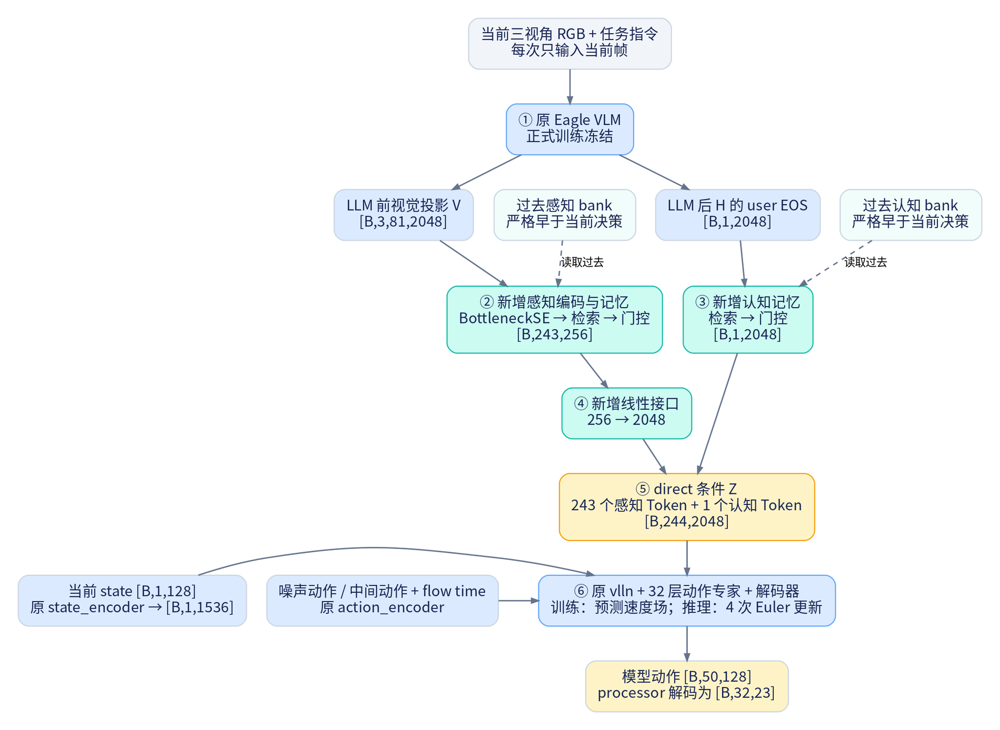
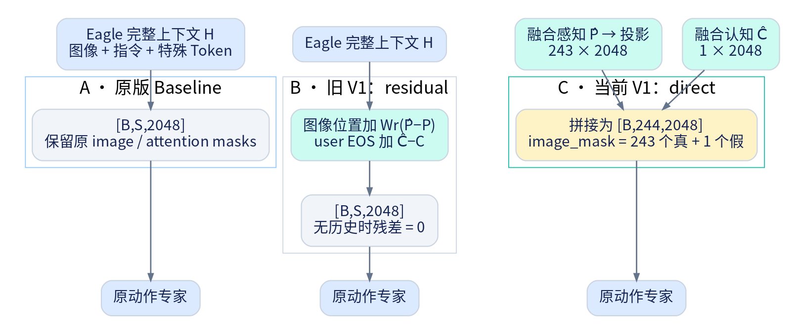
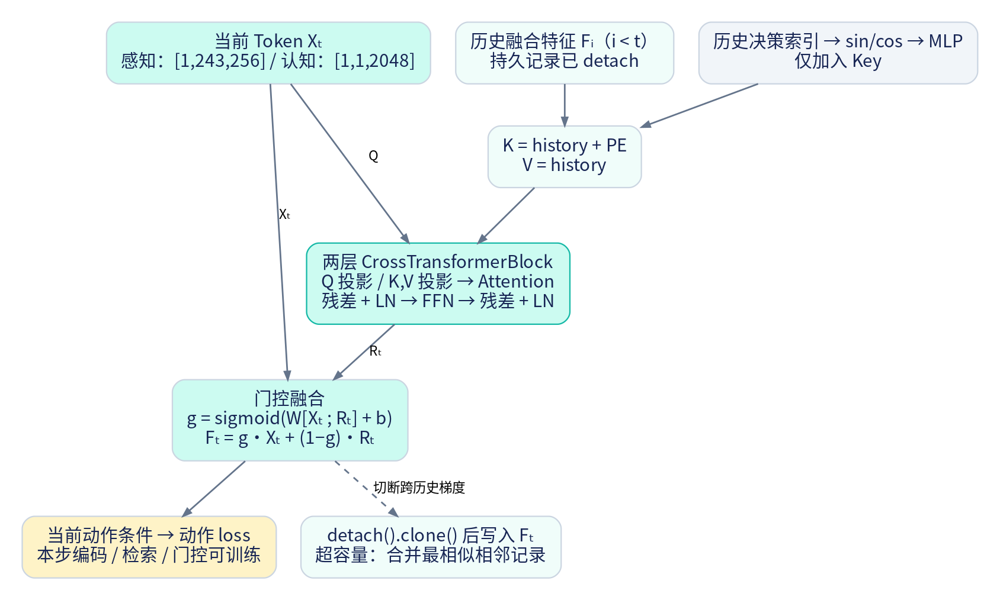
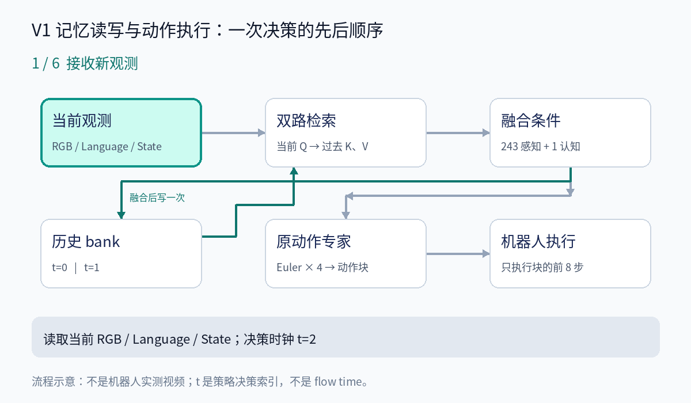
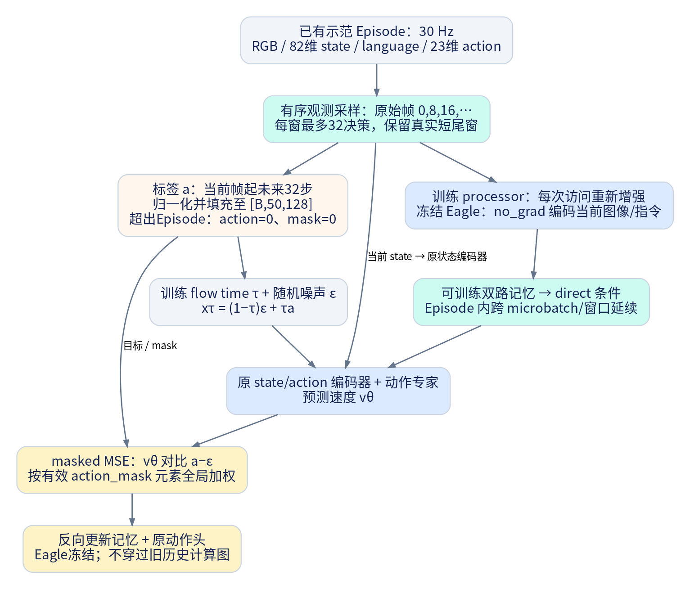

# V1 模型架构：让 GR00T-N1.6 在动作生成时读取历史

本文参照[原 GR00T 模型文档](../references_code/Isaac-GR00T/model.md)，从整体图、模块、推理 Demo 到训练 Demo，解释当前 V1 到底增加了什么。形状以 BEHAVIOR R1 Pro、三相机、B1K checkpoint 为准；核对日期为 2026-11-11。

先抓住核心变化：原 GR00T 把**当前图像和指令**编码后交给动作专家；V1 在两者之间加入**感知、认知两路历史记忆**，让过去的信息先参与当前特征融合，再影响动作。当前新训练使用 direct 接口；旧 residual 权重的区别在后文单独画出。

## 快速导航

- [1. 架构总览图](#1-架构总览图)：先看新增模块放在哪里。
- [2. 模型总览与输入输出](#2-模型总览与输入输出)：对齐类、接口和真实形状。
- [3. 模块详解](#3-模块详解)：视觉压缩、双路检索、融合、动作头。
- [4. 推理 Demo：从观测到机器人动作](#4-推理-demo从观测到机器人动作)：一次请求到底发生什么。
- [5. 训练 Demo：从示范到 Loss](#5-训练-demo从示范到-loss)：历史、未来标签和梯度各走哪条路。
- [6. 关键设计点](#6-关键设计点)：direct/residual、空历史、时间、容量和低 Loss。
- [7. 配置、验证与代码导航](#7-配置验证与代码导航)：按图定位实际实现。

## 1. 架构总览图

### 1.1 高层数据流：V1 插在什么位置

~~~mermaid
flowchart LR
    O["环境当前观测 RGB / state / language"] --> P["原 Policy + Processor"]
    P --> E["原 Eagle VLM"]
    E --> M["新增 V1 双路记忆"]
    M --> A["原动作专家"]
    P -->|"当前 state"| A
    A --> D["原 processor 动作解码"]
    D --> R["环境执行前 8 步"]
    R -->|"新观测"| O
    classDef added fill:#ccfbf1,stroke:#14b8a6,color:#134e4a;
    class M added;
~~~

这里的记忆是特征记忆。Policy 每次仍只提供当前观测，不需要一次请求塞入 64 帧视频；过去的特征由服务端 Memory bank 保留。

### 1.2 模型内部结构：哪些保留，哪些新增

图 1｜蓝色为原 GR00T 模块，绿色为 V1 新增模块，黄色为交给下一阶段的结果。[查看矢量图](media/model/architecture.svg)。

顺着图中的编号读：

1. **Eagle** 同时产生当前视觉特征 V 和经过视觉语言上下文编码的 H。
2. **感知支路**把视觉网格从 2048 维压缩到 256 维，再查询过去的视觉记忆。
3. **认知支路**取 H 的最后有效 user EOS，查询过去的上下文记忆。
4. **感知投影**把融合结果映射回原动作专家接受的 2048 维。
5. **direct 条件**由 243 个融合感知 Token 与 1 个融合认知 Token 组成。
6. **原动作专家**继续读取当前状态、噪声动作和上述条件，生成动作块。

“记忆进入了动作决策”对应一条完整的可微路径：

**历史 → Attention → 门控融合 → 动作条件 → 动作专家 → 动作 Loss。**

历史库的读写本身不是辅助日志；融合后的特征就是动作专家实际接收的条件。

### 1.3 原版、旧 V1、当前 V1 对照

图 2｜关键变化在**交给动作专家的条件内容**，并没有把动作专家重写为另一套网络。[矢量图](media/model/conditioning.svg)。

| 版本 | 动作专家看到什么 | 没有历史时 |
| --- | --- | --- |
| 原版 Baseline | Eagle 完整上下文 H，[B,S,2048] | 每次独立处理当前观测 |
| 旧 V1：residual | H 加上感知/EOS 的融合变化量 | 变化量严格为零，回到 H |
| 当前 V1：direct | 投影后的融合感知 + 融合 EOS，[B,244,2048] | 当前感知仍经过压缩和投影，EOS 保留 |

因此，direct 的“空历史”仍然是一套有感知压缩/投影的网络，不能与原版 Baseline 混称为同一个条件。

## 2. 模型总览与输入输出

### 2.1 四层架构与类的职责

| 层级 | 实际类 / 模块 | 负责什么 |
| --- | --- | --- |
| 观测与调用 | Gr00tPolicy / Gr00tSimPolicyWrapper | 校验输入、设置 Episode 身份、调用模型、解码动作 |
| 数据处理 | Gr00tN1d6Processor / DataCollator | 图像变换、语言、状态/动作归一化、padding |
| 特征与记忆 | EagleBackbone + MemoryAdapter | 当前视觉语言编码、过去检索、当前特征融合 |
| 动作生成 | Gr00tN1d6ActionHead | 状态/动作编码、AlternateVLDiT、速度场预测和积分 |

主体类的关系可简化为下面的结构；这是结构示意，不是构造参数的完整替代：

~~~python
class Gr00tN1d6:
    backbone      # 原 EagleBackbone
    memory        # 新增 MemoryAdapter；Baseline 时为 None
    action_head   # 原 Gr00tN1d6ActionHead

    # 训练与推理都经过：
    # prepare_input → _backbone_with_memory → action_head
~~~

代码：[模型主体](model/gr00t_n1d6/gr00t_n1d6.py)、[MemoryAdapter](model/memory/adapter.py)、[Policy](policy/gr00t_policy.py)。

### 2.2 Policy 侧看到的输入

B1K 当前使用三路相机，顺序是 head、left_wrist、right_wrist。每路只取当前一帧。

~~~python
# 接口示意：以下类型/形状由真实 observation 提供，不是构造假观测的代码。
observation = {
    "video": {
        # checkpoint 中三路相机各自的 modality key
        camera_key: uint8_array,       # [B, 1, 256, 256, 3]，RGB
    },
    "state": {
        state_key: float32_array,     # [B, 1, D_key]
    },
    "language": {
        language_key: [[instruction]], # B=1 时的结构
    },
}
~~~

三个 camera key 为：

~~~text
observation.images.rgb.head_256_256
observation.images.rgb.left_wrist_256_256
observation.images.rgb.right_wrist_256_256
~~~

state 字段包括底盘位置/姿态及其编码、线/角速度、双臂 qpos 和 sin/cos、双 EEF 位姿、夹爪位置、躯干 qpos；拼接后的示范状态为 82 维。processor 将其处理成 [B,1,128]，多出来的位置是填充，不是新增机器人关节。

### 2.3 模型侧的输入与输出

~~~python
# collator 之后的关键字段；图像张量布局以 Eagle collator 实际输出为准。
inputs = {
    "input_ids": ...,       # [B, S]
    "attention_mask": ...,  # [B, S]
    "pixel_values": ...,    # Eagle 所需的多相机图像张量
    "state": ...,           # [B, 1, 128]
    "embodiment_id": ...,   # [B]；本机 BEHAVIOR_R1_PRO 映射为 24
    "memory_context": {
        "mode": "stream",
        "episode_keys": [("client", "env0", "episode0")],  # 此处示例 B=1
        "timesteps": [0],  # 策略决策索引
    },
}
# 训练另有：
# action      [B, 50, 128]
# action_mask [B, 50, 128]
~~~

| 调用 | 输出 | 含义 |
| --- | --- | --- |
| model(inputs) | loss、action_loss、action_mask、features | 训练时预测速度场并计算带 mask 的损失 |
| model.get_action(inputs) | action_pred：[B,50,128] | 积分后得到的模型空间动作 |
| policy.get_action(observation, options) | 六组 [B,32,D_group] 数组 | 经 processor 解码的动作块 |

S 是完整 Eagle 上下文长度，随指令与 padding 改变；244 是当前三相机 direct 条件的固定 Token 数。它们不是动作维度，也不是记忆容量。

## 3. 模块详解

### 3.1 Eagle：当前图像与语言从哪里分成两路

代码：[eagle_backbone.py](model/modules/eagle_backbone.py)。

Eagle 的原始职责没有变化：将三路 RGB 和任务语言编码为上下文特征 H。V1 额外导出视觉模型投影后、进入语言模型之前的 V。

| 特征 | 位置 | 形状 | V1 用途 |
| --- | --- | --- | --- |
| V | LLM 前的视觉投影 | [B,3,81,2048] | 感知支路保留相机内的空间网格 |
| H | LLM 后的上下文 | [B,S,2048] | 从中取最后有效 user EOS，作为认知支路输入 |

每个相机 81 个 Token 对应 9×9 网格；三相机共 243 个。认知 EOS 不是“纯文本向量”：它已经经过当前视觉和语言上下文编码。

EOS 取最后一个满足 input_ids=151645 且 attention 有效的位置，避免误取 system EOS、尾部换行或 padding。

### 3.2 BottleneckSE：感知支路究竟压缩了什么

代码：[bank.py:BottleneckSE](model/memory/bank.py)。

~~~mermaid
flowchart LR
    V["每相机 81×2048"] --> GRID["还原 9×9 网格"]
    GRID --> C1["1×1 Conv 2048→512 + ReLU"]
    C1 --> SE["SE 通道缩放"]
    SE --> C2["1×1 Conv 512→256"]
    C2 --> P["展平并拼三相机 243×256"]
~~~

SE 用空间平均池化估计各通道的权重，再经 512→32→512 的小网络和 Sigmoid 缩放。这里压缩的是**每个 Token 的通道数**；空间 Token 数仍然是 243，不是把整幅图平均成一个 Token。

这让感知 bank 用 256 维记录历史，而不必为每个视觉 Token 保存 2048 维。进入动作专家前再投影回 2048 维。

### 3.3 双路 MemoryBank：如何读取过去

图 3｜同一套机制分别用于感知 bank 和认知 bank，两路参数独立。[矢量图](media/model/memory_bank.svg)。

对于当前特征 Xₜ，执行顺序是：

1. 取当前 Episode 中所有严格早于 t 的记录。
2. 展开历史 Token，构成 Attention 的 Key/Value 输入。
3. 把历史决策索引的时间编码加到 Key，Value 保留历史内容。
4. 当前特征作为 Query，经两层 CrossTransformerBlock 检索。
5. 用门控合并当前特征与检索结果。
6. 融合结果参与当前动作条件，同时 detach 后存入历史。

一层 CrossTransformerBlock 的实际组成：

~~~text
Q/K/V 线性投影
  → 单头 scaled_dot_product_attention
  → 当前 Query 残差 + LayerNorm
  → Linear(D,4D) → GELU → Linear(4D,D)
  → 残差 + LayerNorm
~~~

感知 Query 有 243 个 Token，每条历史也有 243 个感知 Token；认知 Query 只有 1 个 Token，每条历史只有 1 个 EOS Token。两者检索的粒度不同。

### 3.4 GateFusion：当前和历史怎样混合

~~~python
g = sigmoid(linear(concat(current, retrieved)))
fused = g * current + (1 - g) * retrieved
~~~

g 是逐 Token、逐通道的可学习权重，不是手工规定“历史占多少”。投影权重/偏置以约 1e−3 标准差初始化，初始 g 接近 0.5。

无历史时不调用检索和门控，直接令 fused=current。由此避免半精度下本应为零的残差产生舍入误差。

### 3.5 Bank 写入与合并：保存的不是原始视频

| bank | 一条记录保存什么 | 新启动容量 |
| --- | --- | --- |
| 感知 bank | (决策索引, [243,256] 融合特征) | 默认 64 条 |
| 认知 bank | (决策索引, [1,2048] 融合特征) | 默认 64 条 |

写入使用 fused.detach().clone()。达到容量后并非简单删掉最早一帧：代码找出最相似的相邻两条，把特征平均，保留较早时间标签。另有 last_written 保存真实最后写入时刻，防止重复请求写入。

合并后，一条记录可能代表多个过去时刻。因此“容量 64”不等于“恰好保存最近 64 帧原始视频”。

### 3.6 direct 接口：拼成动作专家真正读取的条件

~~~python
# 每条观测的概念形状；batch 维此处省略
perception = perceptual_encoder(V)       # [243, 256]
P_fused = perceptual_bank(perception)    # [243, 256]
C_fused = cognitive_bank(user_eos)       # [1, 2048]

Z = concat(
    perceptual_projection(P_fused),     # [243, 2048]
    C_fused,                            # [1, 2048]
)                                       # [244, 2048]
~~~

对应 masks：

~~~text
Token 位置        0 ……………………… 242       243
内容              融合感知 Token          融合认知 EOS
image_mask        True × 243              False
attention_mask    True × 243              True
~~~

语言通过经过上下文编码的 EOS 保留下来；原完整 H 不再另走一条旁路输入动作专家。

### 3.7 原动作专家：记忆条件如何变成动作

代码：[Gr00tN1d6ActionHead](model/gr00t_n1d6/gr00t_n1d6.py)、[AlternateVLDiT](model/modules/dit.py)。

~~~mermaid
flowchart TD
    Z["V1 条件 Z B×244×2048"] --> LN["原 vlln LayerNorm"]
    LN --> DIT["原 32 层 AlternateVLDiT"]
    S["当前 state B×1×128"] --> SE["原 state_encoder"]
    A["噪声/中间动作 B×50×128"] --> AE["原 action_encoder"]
    T["flow time + embodiment_id"] --> AE
    SE --> CAT["拼接 state 与 action Tokens B×51×1536"]
    AE --> CAT
    CAT --> DIT
    DIT --> DEC["原 action_decoder"]
    DEC --> U["速度场 / 最终模型动作 B×50×128"]
~~~

原动作头有两类输入：**state/action Token 是它要加工的序列**，而 **V1 的 Z 是它通过 cross attention 读取的外部条件**。增加记忆没有替换原来的状态 Token 或动作 Token。

当前代码的 32 个 Transformer block 按下面顺序重复 8 次，默认 attend_text_every_n_blocks=2：

| block 索引 | 操作 | direct 下读取的内容 |
| --- | --- | --- |
| 0 | 非图像 cross attention | 1 个融合认知 Token |
| 1 | state/action self attention | 状态与动作 Token 之间交互 |
| 2 | 图像 cross attention | 243 个融合感知 Token |
| 3 | state/action self attention | 状态与动作 Token 之间交互 |

这比笼统说“奇数层看图、偶数层看文字”更贴合实际实现。记忆会在 cross attention 中被读取，继而改变预测速度场。

## 4. 推理 Demo：从观测到机器人动作

### 4.1 先看一次决策的动图

图 4｜流程动图，每阶段约 1.7 秒。它展示调用顺序，不是实测机器人视频；[静态帧](media/model/memory_cycle.png)可用于不支持 GIF 的阅读器。

最容易混淆的两件事是：**一轮观测只更新一次记忆，但动作生成在同一条件下做四次积分**。

### 4.2 一次真实请求经过哪些层

以首帧和下一次请求为例：

| 阶段 | 首次请求：环境帧 0 | 下次请求：环境帧 8 |
| --- | --- | --- |
| 输入 | 当前三相机、状态、任务语言 | 最新三相机、状态、任务语言 |
| 决策索引 | t=0 | t=1 |
| 检索可见历史 | 空 | 已存的 t=0 |
| 当前条件 | 当前感知投影 + 当前 EOS | 当前/历史融合后的感知投影 + EOS |
| 写库 | 写 t=0 一次 | 写 t=1 一次 |
| 动作生成 | 同一条件下积分 4 次 | 同一条件下积分 4 次 |
| 环境执行 | 动作块前 8 步 | 新动作块前 8 步 |

Episode 身份由 MemoryState 维护，key 为 (session_id, env_id, episode_id)。切换 Episode 或 reset 时只清理对应历史，避免跨客户端、跨环境混用。

### 4.3 最小 Policy 调用

以下片段接收**真实采集且符合 checkpoint schema 的 observation**；不会自动采集观测或执行动作。

~~~python
from v1_groot_memoryvla.policy.gr00t_policy import Gr00tPolicy
from v1_groot_memoryvla.data.embodiment_tags import EmbodimentTag

policy = Gr00tPolicy(
    embodiment_tag=EmbodimentTag.BEHAVIOR_R1_PRO,
    model_path="/path/to/trained_v1_checkpoint",
    device="cuda:0",
)

# observation 是 §2.2 所示的真实嵌套字典，以下示例 B=1。
actions, info = policy.get_action(observation, options={
    "session_id": "v1-demo",
    "env_ids": [0],
    "episode_ids": ["episode-0"],
})
for name, value in actions.items():
    print(name, value.shape)  # [1, 32, 该控制组维数]

# Episode 结束时清理；实际环境中的执行由调用方负责。
policy.reset(options={"session_id": "v1-demo", "env_ids": [0]})
~~~

使用环境扁平字段时，外层套原 Gr00tSimPolicyWrapper；模型内部仍经过同一 MemoryAdapter。

### 4.4 从随机动作到动作块：四次 Euler 更新

~~~python
# 概念伪代码；condition 已经计算完，循环里不调用 MemoryAdapter。
x = randn(B, 50, 128)
for k in range(4):
    flow_time = k / 4             # 0、0.25、0.5、0.75
    velocity = action_head_velocity(
        x, flow_time, state, condition
    )
    x = x + 0.25 * velocity
~~~

这里的 velocity 是**归一化动作轨迹的流速度**，不是机器人底盘速度，也不是关节速度命令。积分得到的 x 仍需解码。

### 4.5 模型 50 步、解码 32 步、执行 8 步

| 层级 | 形状 / 步数 | 下一步处理 |
| --- | --- | --- |
| 模型内部 | [B,50,128] | processor 截取有效时间和动作字段 |
| Policy 输出 | [B,32,23]，拆成六组 | 原 B1K action adapter 处理控制语义 |
| 每轮环境执行 | 前 8 步，每步 23 维 | 重新获取当前观测，再调用 Policy |

23 维动作的顺序和语义：

| 字段 | 维数 | processor 学习空间 → 解码后控制含义 |
| --- | --- | --- |
| base | 3 | 底盘运动命令；还要经过原坐标/缩放适配 |
| torso | 4 | 相对当前 trunk qpos → 绝对关节位置 |
| left_arm | 7 | 相对当前左臂 qpos → 绝对关节位置 |
| left_gripper | 1 | 夹爪控制命令 |
| right_arm | 7 | 相对当前右臂 qpos → 绝对关节位置 |
| right_gripper | 1 | 夹爪控制命令 |

反归一化由 checkpoint processor 及其 statistics/action 配置决定，不能用统一的“乘 std 加 mean”替代所有字段。V1 没改控制器或左右臂顺序。

## 5. 训练 Demo：从示范到 Loss

### 5.1 训练数据流图

图 5｜未来动作只作监督标签；记忆只接触当前及过去的观测特征。[矢量图](media/model/training.svg)。

训练时看见未来动作标签是正常监督学习；把未来动作或未来图像输入当前记忆才是泄漏。图中两条路径需要分开理解。

### 5.2 用具体帧理解一个样本

假设 Episode 有 20 帧，stride=8。会采到三个真实决策观测：

| 当前原始帧 | 输入观测 | 监督动作范围 | 有效监督数 |
| --- | --- | --- | --- |
| 0 | RGB/state/language[0] | action[0:20]，其后补零 | 20×23 |
| 8 | RGB/state/language[8] | action[8:20]，其后补零 | 12×23 |
| 16 | RGB/state/language[16] | action[16:20]，其后补零 | 4×23 |

不会为了凑满 32 个决策复制最后一帧。超出 Episode 的动作，在 processor 归一化后置 action=0、action_mask=0；模型统一形状仍是 50×128。

HistoryCollator 用 group_lengths 记录每组有几个真实决策。正式连续训练还用 sequence_start/end 区分 Episode 边界，让历史跨 microbatch 和窗口延续。

### 5.3 训练目标仍为原 flow matching

记真实归一化动作 a、随机噪声 ε、流时间 τ：

$$
x_\tau=(1-\tau)\epsilon+\tau a,\qquad
u=a-\epsilon
$$

动作专家预测 vθ(xτ, τ, state, Z)，优化：

$$
\mathcal L=
\frac{\sum m\odot(v_\theta-u)^2}{\sum m+10^{-6}}
$$

m 即 action_mask。该 Loss 训练的是动作轨迹速度场，而不是直接预测“这次任务能否成功”。

microbatch / 窗口 / DDP rank 之间按有效 mask 元素数加权：

~~~python
weight_i = valid_action_elements_i / total_valid_action_elements
total_loss = sum(weight_i * loss_i)
~~~

尾窗监督更少，不能按“每个决策权重相同”简单平均。DDP 实现还补偿梯度平均的 world_size。

### 5.4 哪些模块得到梯度

~~~mermaid
flowchart LR
    LOSS["动作 Loss"] -.反向.-> HEAD["原动作专家：可训练"]
    HEAD -.反向.-> MEM["当前编码 / 投影 / 检索 / 门控：可训练"]
    PAST["过去存储的 detached 特征"] --> MEM
    EAGLE["Eagle：冻结"] --> MEM
    classDef frozen fill:#e2e8f0,stroke:#94a3b8;
    class EAGLE,PAST frozen;
~~~

| 模块 | 正式训练默认 | 梯度说明 |
| --- | --- | --- |
| Eagle | 冻结、eval、no_grad 编码 | 不更新视觉语言 backbone |
| 当前感知 BottleneckSE / direct 投影 | 可训练 | 首帧无历史时也能从动作 Loss 获得梯度 |
| 当前检索 / 时间编码 / 门控 | 可训练 | 有历史才真正参与检索 |
| 原 state/action 编码器、DiT、解码器、vlln | 按 tune 配置训练 | 默认正式路径训练原 action_head |
| bank 中旧记录的计算图 | 已 detach | 不沿历史回传到过去时刻 |

### 5.5 最小前向/反向 Demo

这个片段只演示**一个独立有序组**如何产生 Loss；从原始 GR00T 初始化新 direct 网络，运行前应确认显存。它不是正式跨窗/DDP 调度器，也不会因为出现在文档里而自动执行。

~~~python
import torch
from v1_groot_memoryvla.model.gr00t_n1d6.gr00t_n1d6 import Gr00tN1d6
from v1_groot_memoryvla.model.gr00t_n1d6.processing_gr00t_n1d6 import Gr00tN1d6Processor
from v1_groot_memoryvla.data.dataset.history_dataset import HistoryDataset, HistoryCollator

checkpoint = "checkpoints/groot_n1d6_behavior1k"  # 原始无记忆权重
processor = Gr00tN1d6Processor.from_pretrained(checkpoint)
processor.train()

model = Gr00tN1d6.from_pretrained(
    checkpoint,
    memory_enabled=True,
    memory_conditioning="direct",
    memory_length=64,
    tune_llm=False, tune_visual=False, tune_top_llm_layers=0,
    backbone_trainable_params_fp32=False,
    torch_dtype=torch.float32,
).cuda()
model.train()
model.backbone.requires_grad_(False).bfloat16().eval()

dataset = HistoryDataset(
    ["assets/datasets/b1k2025_groot_task0_v1_200"],
    processor, group_size=4, history_stride=8,
)
collate = HistoryCollator(processor.collator, group_size=4)
inputs = collate([dataset[0]])["inputs"]  # 含真实 group_lengths 与 memory_context

with torch.autocast("cuda", dtype=torch.bfloat16):
    outputs = model(inputs)
outputs["loss"].backward()

projection = model.memory.perceptual_projection
print("loss:", outputs["loss"].item())
print("projection grad:", projection.weight.grad.norm().item())
~~~

新建记忆层出现 missing memory keys 是初始化行为；加载已训练 V1 时则必须确认已训练参数完整恢复。已有权重的训练/恢复应使用实际正式入口，不能把这个独立组 Demo 当续训代码。

### 5.6 正式训练的顺序与图像增强

正式协议每个虚拟槽持续处理同一 Episode，结束后才切换；每个 Episode 固定 rank 所有权，多任务按任务均衡轮转。单窗最多 32 个决策；容量 64 与窗口长度独立。

训练 processor 默认开启 checkpoint 的图像增强。即使 Eagle 冻结，每次重新访问训练窗口也要重新增强、重新编码；不能把第一次随机增强结果永远缓存。增强种子按优化步/虚拟槽确定，包含 Albumentations 的独立 RNG。验证和 wrong donor 使用 eval processor。

正式训练采用 FP32 可训练参数与 BF16 autocast；在线 Policy 的加载 dtype 可能不同。检查动作影响时需固定 dtype、模式和随机动作噪声。

## 6. 关键设计点

### 6.1 为什么从 residual 改成 direct

旧 residual 接口是：

~~~text
H′[image] = H[image] + Wr(P̂−P)
H′[EOS]   = H[EOS]   + (Ĉ−C)
~~~

它保留完整 H，并仅加入“历史融合带来的差”。无历史时 P̂=P、Ĉ=C，残差严格为零，首帧不能通过这条差分训练感知压缩/残差投影。

当前 direct 则让当前感知经过压缩/投影后直接成为动作条件；无历史时这些新增参数也参与动作计算。这样能验证记忆表征自身是否可用，但**并不保证模型必然依赖历史**：当前图像和原 state 仍然可能足以解释训练数据。

两种接口参数名分别为 perceptual_residual 与 perceptual_projection；不能把旧权重简单改个配置就认作等价的新模型。

### 6.2 normal / empty / wrong 到底改变什么

| 条件 | 当前观测 | 历史 | 动作头与条件形状 |
| --- | --- | --- | --- |
| normal | 目标观测 | 自身严格过去历史 | 相同 |
| empty | 目标观测 | 不读、不写；当前编码仍保留 | 相同 |
| wrong | 目标观测 | 独立同任务训练 Episode 的内容，匹配目标时间槽 | 相同 |

三种条件都经过相同的动作推理接口。验证时隔离 bank/时钟，结束恢复原训练历史。direct 的 empty 是“去掉过去”，不是绕过感知投影、退回完整 H。

### 6.3 三种“时间”和两种“长度”

| 名称 | 示例 | 用途 |
| --- | --- | --- |
| 环境帧索引 | 0、8、16 | 30Hz 仿真/示范时刻 |
| 记忆决策索引 | 0、1、2 | bank 时间编码和因果顺序 |
| flow time | 0、0.25、0.5、0.75 | 一次动作块内部的积分阶段 |
| 训练窗口长度 | 最多 32 决策 | 一次展开与数据调度 |
| bank 容量 | 默认 64 条 | 每条支路的历史记录容量 |

### 6.4 LayerNorm 修复影响哪里

原 action_head 的 process_backbone_output 现在返回新的 BatchFeature，不再覆盖调用方传入的 backbone_features。这样同一份融合特征被 Loss 和动作预测复用时，各自只做一次 vlln，不会把第二条路径的输入变成已经归一化过的特征。

### 6.5 Loss 低，为什么不等于“记忆已经有用”

本结构确保历史存在通向动作的路径，但训练目标没有要求“必须依赖过去”。已有 50 任务权重可能已经很擅长利用当前观测，成功示范中的历史又可能冗余；detach 也限制了跨历史优化的范围。这些是需要检验的解释，不能只凭 Loss 选定根因。

更直接的检查是在同一当前观测、同一动作噪声下，对 normal/empty/wrong 分别观察检索变化、动作变化与有效梯度。闭环任务表现还需同起点、同数据、同训练预算评估。现有代码中的 MAE 字段不作为本文的效果证据。

## 7. 配置、验证与代码导航

### 7.1 新启动默认与旧 checkpoint 默认

| 项目 | 新正式运行 | 旧权重兼容 / 类默认 |
| --- | --- | --- |
| conditioning | direct | 未保存该字段时 residual |
| 每路 bank 容量 | 64，可配置 | 类默认 16，以 checkpoint 保存值为准 |
| 正式训练窗口 | 最多 32 决策 | 类默认 16 |
| stride | 8 环境步 | 8 |
| 感知维度 / 检索层数 | 256 / 2 | 256 / 2 |
| 图像增强 | 默认开启 | 由 processor 模式决定 |

新协议名为 memoryvla_direct_tail_v2，其中 v2 是**V1 协议修订号**，不是本体建模项目 V2。正式入口为 train/run_groot_train.sh 或训练网页：

~~~bash
--memory-conditioning direct --memory-length 64 --image-augmentation
~~~

新 direct 从明确选择的原始 GR00T 权重初始化；已有 residual 运行保留其配置和固定源码。恢复完整训练还要包含优化器、数据游标、RNG 和 bank 运行态。详见 [RETRAIN.md](RETRAIN.md)。

### 7.2 验证结果与范围

已有验证覆盖真实记忆/动作头的前向、梯度、尾窗 mask、因果性、增强、分块一致性和 checkpoint 重载。[RETRAIN.md](RETRAIN.md)另记录完整 3B 权重两观测检查：direct 条件 [2,244,2048]，全部 75 项记忆参数有有限梯度。

V1/V2 同步后的联合回归记录为 109 passed，见 [V2 实现报告](../v2_groot_memoryvla/v2_implementation_report.md)。这不是闭环成功率结果；本次改写仅更新教学文档和图示，没有进行新的训练或机器人执行。

### 7.3 按图定位代码

| 想理解什么 | 先读哪里 |
| --- | --- |
| 图 1 的主路径 | [Gr00tN1d6._backbone_with_memory](model/gr00t_n1d6/gr00t_n1d6.py) |
| V 与 H 的来源 | [EagleBackbone.forward](model/modules/eagle_backbone.py) |
| 图 2 的 direct/residual 差别 | [MemoryAdapter.forward](model/memory/adapter.py) |
| 图 3 的压缩、检索、门控与合并 | [bank.py](model/memory/bank.py) |
| 原动作专家如何读取记忆 | [ActionHead](model/gr00t_n1d6/gr00t_n1d6.py) 与 [AlternateVLDiT.forward](model/modules/dit.py) |
| 图 4 的 Episode 与决策时钟 | [memory_state.py](policy/memory_state.py)、[gr00t_policy.py](policy/gr00t_policy.py) |
| 图 5 的尾窗和标签 | [history_dataset.py](data/dataset/history_dataset.py)、[episode_windows.py](data/dataset/episode_windows.py) |
| 连续训练、加权与增强 | [task21_formal.py](experiment/task21_formal.py)、[task21_ddp.py](experiment/task21_ddp.py) |
| 从 V1 到本体条件化 V2 | [V2 model.md](../v2_groot_memoryvla/model.md) |

图示的 DOT/SVG 源文件与 PNG/GIF 位于 [media/model](media/model)。生成脚本为 [render_memory_model_docs.py](../../scripts/render_memory_model_docs.py)，可按实际代码变化重新渲染。

在仓库根目录使用已有 V1 环境重新生成所有图示（需要 Graphviz、Pillow 和 Noto CJK 字体）：

~~~bash
src/v1_groot_memoryvla/.venv/bin/python scripts/render_memory_model_docs.py
~~~
