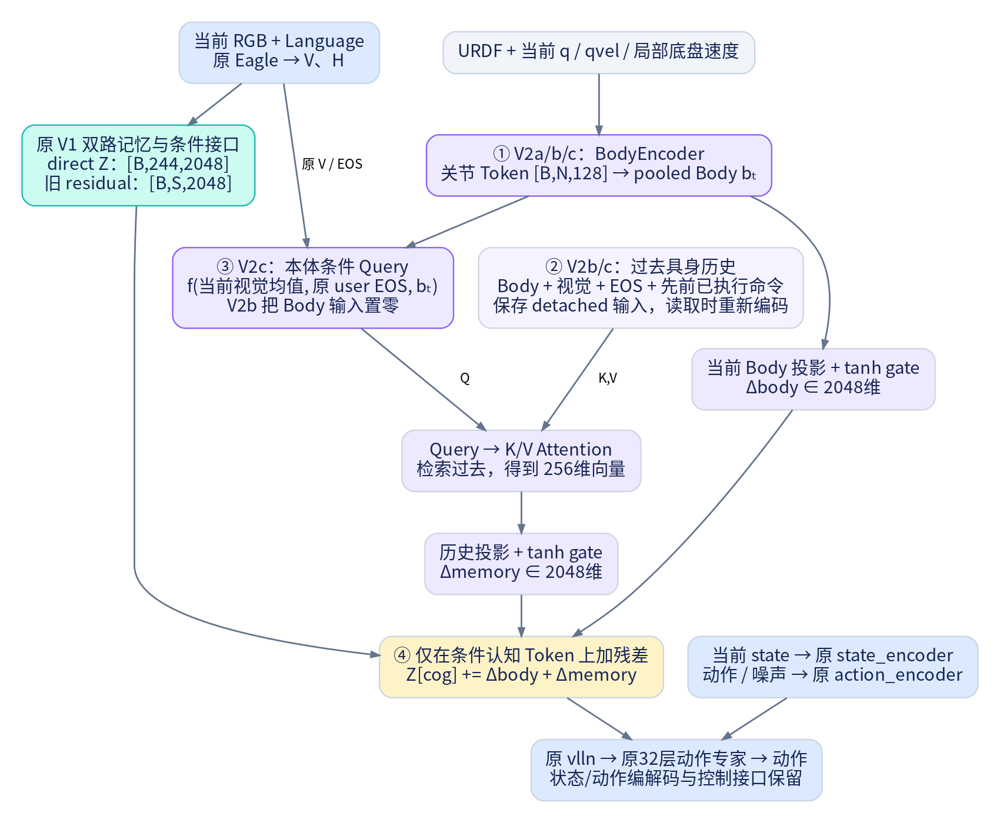
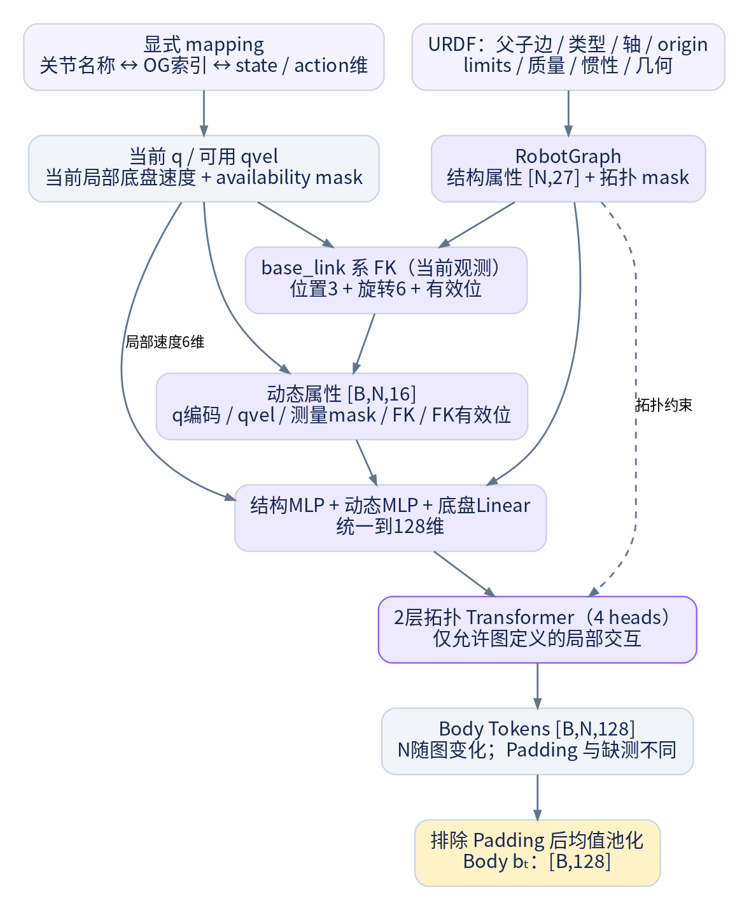
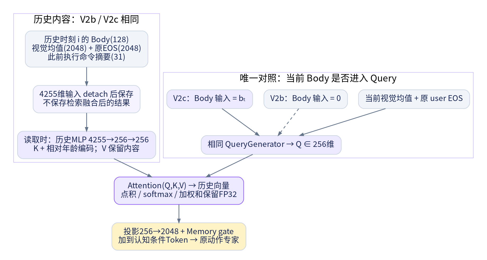

# V2 模型架构：用机器人本体构型参与记忆与检索

本文延续[原 GR00T 模型文档](../references_code/Isaac-GR00T/model.md)的讲解顺序，说明 V2 怎样在[最新 V1](../v1_groot_memoryvla/model.md)上增加 Body Encoder、具身历史和本体条件化检索。核对日期：2026-11-11。

V1 回答“当前视觉/语言与过去怎样融合”；V2 进一步把**机器人结构、当前构型和过去实际执行命令**加入计算。核心要验证的是：在同一段历史上，当前构型能否帮助模型选出更有用的信息。代码中已经有可训练路径；是否提升成功率仍需实验。

## 快速导航

- [1. 架构总览图](#1-架构总览图)：从 V1 到 V2 增加哪几条路径。
- [2. 模型总览与五种配置](#2-模型总览与五种配置)：Baseline / V1 / V2a / V2b / V2c。
- [3. Body Encoder：机器人怎样变成 Token](#3-body-encoder机器人怎样变成-token)。
- [4. 具身历史与本体条件化检索](#4-具身历史与本体条件化检索)。
- [5. 动作融合：新增信息在哪里影响动作](#5-动作融合新增信息在哪里影响动作)。
- [6. 推理 Demo：一次真实调用](#6-推理-demo一次真实调用)。
- [7. 训练 Demo：从示范到梯度](#7-训练-demo从示范到梯度)。
- [8. 关键设计、兼容与代码导航](#8-关键设计兼容与代码导航)。

## 1. 架构总览图

### 1.1 高层数据流

~~~mermaid
flowchart LR
    VL["当前图像 + 任务语言"] --> V1["原 Eagle + V1 双路记忆"]
    V1 --> Z["V1 动作条件"]
    R["URDF + 当前本体状态"] --> B["V2a：Body Encoder"]
    B --> Z
    VL --> Q["V2c：当前 VL + Body 生成 Query"]
    B --> Q
    H["V2b：过去 VL + Body + 已执行命令"] --> RET["历史检索"]
    Q --> RET
    RET --> Z
    Z --> A["原 GR00T 动作专家"]
    S["原 state 输入路径"] --> A
    classDef added fill:#ede9fe,stroke:#8b5cf6,color:#3b0764;
    class B,Q,H,RET added;
~~~

这张图中的 Body 有两条作用路径：**当前 Body 残差直接影响动作条件**，以及 **Body 改变 Query，再通过历史检索间接影响动作条件**。后者才是 V2b/V2c 的核心对照。

### 1.2 完整内部结构

图 1｜蓝色保留原 GR00T，绿色保留 V1，紫色为 V2 新增模块，黄色为融合位置。[矢量图](media/model/architecture.svg)。

按新增部分的编号理解：

1. **Body Encoder**读取 URDF 与当前构型，产生关节 Token 和 pooled Body。
2. **具身历史 bank**保存过去的 Body、视觉、语言，以及当时此前已执行的命令。
3. **Body-conditioned Query**让当前构型参与选择历史。
4. **认知条件残差**把当前 Body 和检索结果加到 V1 的认知 Token，再交给原动作专家。

原 state_encoder 依然接收当前 state。Body 分支是额外的结构化表示，没有替换它。

### 1.3 V1 条件如何被扩展

direct 接口时，Token 变化非常具体：

~~~text
V1：
[ 感知 Token 0 ……………………… 感知 Token 242 ][ 认知 Ĉₜ ]
                  243 个                         1 个

V2a：
[ 感知 Token 0 ……………………… 感知 Token 242 ][ Ĉₜ + Δbody ]

V2b / V2c：
[ 感知 Token 0 ……………………… 感知 Token 242 ][ Ĉₜ + Δbody + Δmemory ]
~~~

条件长度仍然是 244，新增 Body Tokens 经过池化/投影后融合到认知 Token；当前实现没有把 N 个关节 Token 全部追加到动作专家序列中。

旧 residual 权重则保留完整 H，在其中最后有效 user EOS 处加同样的 V2 残差。两种接口的定位不能混用。

## 2. 模型总览与五种配置

### 2.1 五种实验配置分别增加什么

| 配置 | 原 V1 双路记忆 | 当前 Body | 新具身历史 | 当前 Body 进入 Query |
| --- | --- | --- | --- | --- |
| Baseline | 无 | 无 | 无 | 无 |
| V1 | 有 | 无 | 无 | 无 |
| V2a | 有 | 有 | 无 | 无 |
| V2b | 有 | 有 | 有 | 置零 |
| V2c | 有 | 有 | 有 | 有 |

V2a 用来检查当前本体表示是否有用。V2b 相比 V2a 增加历史本体信息，但检索只根据当前视觉和语言。V2c 再让当前 Body 参与 Query。

V2b/c 的模块和参数量相同，bank 容量与历史写入规则相同；通过将 V2b 的 Query Body 输入置零形成对照。复制权重并固定同一输入时，两者历史内容相同，检索依据不同。

### 2.2 实际代码是组合，不是复制模型

~~~python
class V2Model:
    base       # 完整原 V1 Gr00tN1d6：Eagle + MemoryAdapter + ActionHead
    extension  # V2Adapter：BodyEncoder / Query / 具身历史 / 残差投影
    mapper     # URDF ↔ state/action 显式映射
~~~

训练和推理共用：

~~~text
forward(inputs) / get_action(inputs)
  → 原 prepare_input
  → 冻结 Eagle
  → fuse：V1 memory → V2 extension
  → 原 action_head

forward_cached(...)
  → 相同 fuse
  → 相同 action_head
~~~

因此，相同的 V2 融合不是只存在于训练脚本中；RGB 推理和特征缓存训练都调用它。

代码：[model.py](model.py)、[adapter.py](adapter.py)。

### 2.3 关键形状速览

| 张量 | 形状 | 含义 |
| --- | --- | --- |
| 当前 Eagle V / H | [B,3,81,2048] / [B,S,2048] | 沿用 V1 |
| 原 V1 direct 条件 | [B,244,2048] | 沿用 V1 |
| q、qvel、previous_action 及其 masks | [B,N] | 按 URDF 节点映射的本体数组 |
| 静态 / 动态属性 | [N,27] / [B,N,16] | BodyEncoder 的节点输入 |
| Body Tokens / pooled | [B,N,128] / [B,128] | 关节表示与整体表示 |
| 历史输入 | 每条 4255 维 | Body + 视觉 + EOS + 命令摘要 |
| Query / 检索输出 | 256 维 | 新具身 bank 的检索空间 |
| Δbody / Δmemory | 2048 维 | 加到认知条件的残差 |
| 模型动作 | [B,50,128] | 原动作专家输出 |
| processor 解码 | 六组 [B,32,D_group] | 总维数 23，环境每轮执行前 8 步 |

N 随机器人图变化。当前 R1Pro 补齐 EEF 标记后 N=38，这个数量不是写死在网络权重中的。

## 3. Body Encoder：机器人怎样变成 Token

### 3.1 模块内部图

图 2｜结构、当前构型和测量可用性分别进入网络。[矢量图](media/model/body_encoder.svg)。

代码：[kinematics.py:RobotGraph](kinematics.py)、[data.py:BodyMapper](data.py)、[body.py:BodyEncoder](body.py)。

### 3.2 静态结构：URDF 提供什么

每个节点的静态属性是 27 维：

| 内容 | 维数 | 说明 |
| --- | --- | --- |
| joint type one-hot | 4 | fixed / revolute / continuous / prismatic |
| joint axis | 3 | 关节运动轴 |
| origin xyz / rpy | 3 + 3 | 相对父节点的静态变换 |
| lower / upper / 有限范围标志 | 2 + 1 | 连续关节不假设有有限角度区间 |
| 质量 | 1 | 来自连杆 inertial |
| 惯性矩阵独立元素 | 6 | ixx/ixy/ixz/iyy/iyz/izz |
| 几何尺寸或 mesh scale / 几何有效位 | 3 + 1 | 当前不读取 mesh 顶点 |
| **合计** | **27** | 进入结构 MLP |

节点包含根与关节对应的子连杆；URDF 父子边构成拓扑。Attention 每层只允许节点关注自己、父节点和直接子节点，两层可逐步传递邻域信息。它不是所有关节完全互相注意的全连接图。

### 3.3 当前构型：动态 16 维是什么

| 内容 | 维数 | 来源 |
| --- | --- | --- |
| q 的范围缩放值 | 1 | 有上下限时按范围缩放；连续关节该项为零 |
| sin(q)、cos(q) | 2 | 仅对角度关节使用 |
| qvel | 1 | 原始数据可用值，或向后差分 |
| q 可用位、速度可用位 | 2 | 不把缺测当成真实零值 |
| FK 位置 | 3 | 当前 base_link 系 |
| FK 旋转的前两列 | 6 | 连续旋转表示 |
| FK 有效位 | 1 | 依赖当前分支的测量完整性 |
| **合计** | **16** | 进入动态 MLP |

当前局部底盘线/角速度另有 6 维，经 Linear 映射后广播到各节点。观测中的世界系速度由已有机器人姿态旋转到本体系，没有加入物体真值或世界地图。

### 3.4 映射和正运动学为何不可省略

训练 state 的顺序、OG 关节数组的顺序、URDF 的遍历顺序并不相同。尤其双臂的 OG 索引存在交错，不能简单取“前七维是左臂”。

显式映射存放在 [r1pro_mapping.json](configs/r1pro_mapping.json)：

~~~text
URDF joint name
  ↔ OG q index
  ↔ 转换后 state 字段及字段内索引
  ↔ 最终 23 维动作索引
~~~

FK 根据结构和当前 q 计算节点相对根坐标系的位姿。R1Pro 的 USD 还带有 URDF 中没有的 EEF 固定标记，mapping 里补充了来源明确的固定变换。URDF 的 steering/wheel 节点不能与 USD 的六个虚拟底盘自由度按顺序绑定；未观测节点保留结构并设测量 mask。

### 3.5 从属性到 Body 表示

~~~python
# 概念伪代码
x = static_mlp(static_27d)
x = x + dynamic_mlp(dynamic_16d)
x = x + base_linear(local_velocity_6d)

x = topology_transformer_layer_1(x)
x = topology_transformer_layer_2(x)
tokens = layer_norm(x)                 # [B, N, 128]
body = masked_mean(tokens, padding)    # [B, 128]
~~~

两层 Transformer 默认 4 heads、FFN 宽度 256、dropout=0。不同机器人逐图编码，输出再 padding。

“缺测节点”和“padding 节点”含义不同：缺测节点仍属于真实机器人，其结构属性可用；padding 是为 batch 补出的非节点，不参与池化。

当前 BodyEncoder 不读取 previous_action。这样 V2a 只表示当前结构/构型，历史命令的价值留到 V2b/c 检验。

## 4. 具身历史与本体条件化检索

### 4.1 先看 V2b 与 V2c 唯一要改变的部分

图 3｜左侧历史内容相同；右侧 Query 是否读取 Body 是对照变量。[矢量图](media/model/retrieval.svg)。

代码：[memory.py](memory.py)、[adapter.py](adapter.py)。

### 4.2 每个过去时刻究竟写入什么

历史时刻 i 的输入向量：

~~~text
pooled Bodyᵢ       128
视觉均值 V̄ᵢ      2048   ← 对相机和网格 Token 取均值
原 user EOSᵢ      2048   ← 原 H 的上下文 Token
执行命令摘要        31
─────────────────────
总计               4255 维
~~~

这里使用原始 Eagle 的当前视觉/语言信息，不使用检索融合后的输出。这样不会因 V2b/c 检索结果不同而立刻改变下一步的历史写入内容。

命令摘要由两部分构成：

- 27 维：把节点此前命令与其 URDF 静态属性加权汇总。
- 4 维：此前底盘命令 3 维，以及此前命令是否存在的 1 维标志。

这是一种压缩摘要；当前实现没有保存完整逐关节历史动作 Token，可能损失细粒度关节关联，需要后续对照判断。

### 4.3 历史为何保存输入，而不是保存学完的 256 维特征

新 bank 写入：

~~~python
stored = history_input.detach().clone()        # 4255维
~~~

读取时才执行：

~~~python
encoded_history = history_encoder(stored)     # 4255→256→256
~~~

detach 切断的是旧时刻计算图。当前读取时仍会运行 history_encoder，因此它可以从当前动作 Loss 得到梯度。若把已经编码的 256 维特征 detach 后存储，又在读时直接使用，历史编码器就容易失去这条训练路径。

原 V1 bank 保存的是融合特征；V2 新 bank 保存的是重新编码所需的输入。两者不是同一种存储内容。

### 4.4 当前 Query 怎么构造

当前视觉均值、原 user EOS、pooled Body 各投影到 128 维，拼成 384 维，再经 MLP 生成 256 维 Query：

~~~python
q_body = body if variant == "v2c" else zeros_like(body)

query = fuse_mlp(concat(
    visual_projection(current_visual_mean),   # 2048→128
    language_projection(current_user_eos),    # 2048→128
    body_projection(q_body),                  # 128→128
))                                           # 384→256→256
~~~

V2b 置零的是 Body **输入**，保留该层参数和偏置；V2b 的 query.body.weight 梯度按设计为零。当前 Body 残差与历史内容都不随这个消融一起关闭。

### 4.5 Attention 如何取回历史

~~~python
values = history_encoder(past_inputs)
ages = log1p(current_step - past_steps)
pe = age_encoder(stack((sin(ages), cos(ages)), dim=-1))

scores = dot(q_proj(query), k_proj(values + pe)) / sqrt(256)
weights = softmax(scores)
retrieved = output_projection(sum(weights * v_proj(values)))
~~~

年龄编码使用决策间隔，不使用完成进度或未来时间。当前实现的 Q/K 点积累加、softmax 与加权和保留 FP32，避免 BF16 舍入让小幅构型变化在 Attention 中消失。

没有历史时 retrieved=0、attention 为空；依然有当前 Body 残差。

### 4.6 用一个具体场景理解检索假设

例如，历史中有“机械臂收拢时移动底盘”和“伸臂接近物体”的不同片段。当前图像相似，但机器人构型不同，所需动作可能不同。

V2b 只能用当前视觉和 EOS 区分历史；V2c 的 Query 还能看到当前 Body，因此有机会改变对历史的权重。**这解释的是设计要验证的机制，不是当前网络已经学会这些阶段或检索语义。**代码没有手工阶段标签或规则专家。

## 5. 动作融合：新增信息在哪里影响动作

### 5.1 两项残差的公式

~~~python
delta_body = tanh(body_gate) * body_projection(body)
delta_memory = tanh(memory_gate) * memory_projection(retrieved)

condition[cognitive_position] += delta_body + delta_memory
~~~

两个 gate 初值均为 0.01；V2a 没有 delta_memory。tanh 让门控可学习且有界，小初值让新增随机模块的初始扰动较小，但没有保证实际扰动或训练效果一定合适。

### 5.2 原 EOS 与融合后认知 Token 是两个位置

| 位置 | 来源 | 用途 |
| --- | --- | --- |
| 原 H 中最后有效 user EOS | [B,S,2048] 的 token 索引 | 当前 Query 和新历史输入的语言/上下文信息 |
| direct 条件唯一非图像 Token | [B,244,2048] 的索引 243 | 接收 Δbody、Δmemory，再交给动作专家 |
| residual 条件的 user EOS | 保留完整 H′ | 接收 Δbody、Δmemory |

最新兼容逻辑从融合后 masks 定位 direct 的唯一认知 Token。原 H 的 EOS 索引可能是 284 等值，不能直接拿来索引 244 长度的条件。

### 5.3 Body 通过两条路径获得动作梯度

~~~mermaid
flowchart LR
    B["当前 Body"] --> D["当前残差 Δbody"]
    B --> Q["V2c Query"]
    Q --> W["历史 Attention 权重"]
    H["相同过去历史"] --> W
    W --> M["检索残差 Δmemory"]
    D --> C["认知条件"]
    M --> C
    C --> A["原动作专家"]
    A --> L["动作 Loss"]
~~~

只看动作发生变化，可能只是直接 Body 残差起作用。要证明 Query 检索路径有效，需要保持 Body 残差和历史内容相同，单独把 Query 的 Body 输入置零，再观察 Attention 和动作。

## 6. 推理 Demo：一次真实调用

### 6.1 时间对齐先于网络调用

沿用 [V1 记忆读写动图](../v1_groot_memoryvla/media/model/memory_cycle.gif)中的顺序，V2 多了一个必须准确反馈的量：**当前观测之前最后实际执行的命令**。

以 30Hz、每轮执行 8 步为例：

~~~mermaid
sequenceDiagram
    participant E as 环境
    participant P as V2 Policy
    participant M as V1 + V2 Memory
    E->>P: obs[0]，首帧无此前命令
    P->>M: t=0，当前Body/VL；读空历史再写入
    P-->>E: 预测动作块
    Note over E: 实际执行其中前8步
    E->>P: obs[8] + 实际已下发 action[7] + 时间
    P->>M: t=1，读取过去；当前观测不读 action[8]
    P-->>E: 根据最新观测生成新的动作块
~~~

离线训练时，obs[8] 的此前动作是示范 action[7]；在线时则是控制器真正收到的最后命令，不能假设上次预测块的末项已经执行。

### 6.2 当前 Body 输入字段

~~~python
# BodyMapper 输出；N 是机器人图节点数。
body = {
    "q": ...,                # [B,N]
    "qvel": ...,             # [B,N]
    "q_mask": ...,           # [B,N]
    "velocity_mask": ...,    # [B,N]
    "previous_action": ...,  # [B,N]，此前最终23维命令映射到关节
    "action_mask": ...,      # [B,N]，该历史命令字段是否可用
    "base": ...,             # [B,10]：当前局部速度6 + 此前底盘命令3 + 标记1
    "timestamp": ...,        # [B]
}
~~~

这里 body.action_mask 与训练标签 action_mask 是两种 mask：前者标记此前命令是否可用，后者标记未来动作监督哪些元素有效。

### 6.3 最小 Policy 调用示例

以下接收实际环境的扁平 B1K observation，不构造假状态，也不自动执行机器人动作：

~~~python
from v2_groot_memoryvla.policy import V2Policy, V2SimPolicyWrapper

policy = V2SimPolicyWrapper(V2Policy.load(
    "/path/to/v2_checkpoint", device="cuda:0"
))

# 首帧：观测时间来自采集时刻，不是网络接收时间。
actions, _ = policy.get_action(flat_observation_0, options={
    "session_id": "v2-demo",
    "env_ids": [0],
    "episode_ids": ["episode-0"],
    "observation_timestamps": [0.0],
})

# 调用方执行前8步后，取得真实的新观测和最后实际下发命令。
actions, _ = policy.get_action(flat_observation_8, options={
    "session_id": "v2-demo",
    "env_ids": [0],
    "episode_ids": ["episode-0"],
    "observation_timestamps": [8 / 30],
    "executed_actions": [last_command_sent_to_env],  # [23]，最终控制命令
    "executed_action_timestamps": [7 / 30],
})
~~~

V2SimPolicyWrapper 还会保留同一次观测中可用的真实 qvel，避免被原 V1 的 modality 选择丢掉。缺少速度时用 availability mask；在线不会访问未来帧计算速度。

目前旧 V1 evaluator 没有自动发送这些新反馈字段。接 V2 环境调用方时必须传入，不应直接把旧客户端视为已经集成完成。

## 7. 训练 Demo：从示范到梯度

### 7.1 数据流与原 V1 的区别

~~~mermaid
flowchart TD
    EP["已有 Episode：RGB / state / action / timestamp"] --> V1D["原 V1 采样：真实帧0,8,16,…"]
    EP --> MAP["BodyMapper：q、速度、FK、action[t-1]"]
    V1D --> PROC["原 processor / collator"]
    MAP --> ALIGN["按同一 frame_indices 加 body"]
    PROC --> ALIGN
    ALIGN --> E["冻结 Eagle → V1 Memory"]
    ALIGN --> B["BodyEncoder / 新具身历史"]
    E --> F["共享 fuse"]
    B --> F
    F --> HEAD["原动作头 + 原 masked flow matching"]
    HEAD --> LOSS["按有效动作元素加权 Loss"]
~~~

V2HistoryDataset / V2HistoryCollator 继承最新 V1 的短尾窗、未来动作标签 mask 和 group_lengths，只按相同真实帧增加 body，不改动作标签。

速度优先读取配对原始 256 维状态中的 qvel。只有 82 维转换数据时，用完整 30Hz 轨迹的 q[t]−q[t−1] 向后差分；不使用未来帧，首帧速度不可得则 mask=0。

### 7.2 最小前向/反向 Demo

示例从已训练 V1 初始化，自动继承该 checkpoint 的 direct/residual 与容量；演示一个独立有序组：

~~~python
import torch
from v1_groot_memoryvla.model.gr00t_n1d6.processing_gr00t_n1d6 import Gr00tN1d6Processor
from v2_groot_memoryvla.config import V2Config
from v2_groot_memoryvla.model import V2Model
from v2_groot_memoryvla.dataset import V2HistoryDataset, V2HistoryCollator

checkpoint = "/path/to/trained_v1_checkpoint"
urdf = "assets/simulation/omnigibson-robot-assets/models/r1pro/urdf/r1pro.urdf"

model = V2Model.from_v1(
    checkpoint,
    V2Config(variant="v2c"),  # 原 V1 设置自动继承；新具身 bank 默认64
    urdf,
).cuda()
processor = Gr00tN1d6Processor.from_pretrained(checkpoint)
processor.train()
model.train()  # Eagle 仍被冻结并保持 eval

dataset = V2HistoryDataset(
    ["assets/datasets/b1k2025_groot_task0_v1_200"],
    processor, mapper=model.mapper,
    group_size=4, history_stride=8,
)
collate = V2HistoryCollator(processor.collator, group_size=4)
inputs = collate([dataset[0]])["inputs"]

with torch.autocast("cuda", dtype=torch.bfloat16):
    outputs = model(inputs)
outputs["loss"].backward()

print("Body grad:",
      model.extension.body_encoder.dynamic[0].weight.grad.norm().item())
print("Query grad:",
      model.extension.query.fuse[0].weight.grad.norm().item())
~~~

单组至少有历史后才会激活检索；一帧 Episode 的空历史无法验证检索参数梯度。该片段不是正式多卡调度或中途续训脚本。

### 7.3 当前训练入口支持到哪里

[pilot.py](pilot.py)提供有界的实际 checkpoint 检查：

| 阶段 | 数据/噪声 | 用途 |
| --- | --- | --- |
| 固定组拟合 | 固定 eval 图像特征、固定噪声 | 检查新增层能否拟合少量样本 |
| 随机短训 | 默认每步重增强/编码，变化的动作噪声 | 检查普通训练模式和有限梯度 |
| 动作干预 | 固定 eval 特征和同一动作噪声 | 隔离 Body/历史/Query 的影响 |
| 保存/重载 | 完整或轻量 checkpoint | 检查参数与动作恢复一致 |

命令示例，输出目录须不存在；这里只给命令，不启动任务：

~~~bash
PYTHONPATH=src CUDA_VISIBLE_DEVICES=1 \
  src/v1_groot_memoryvla/.venv/bin/python -m v2_groot_memoryvla.pilot \
  --checkpoint checkpoints/v2_init_v1_task21_step003000 \
  --config src/v2_groot_memoryvla/configs/v2c.json \
  --output outputs/v2_groot_memoryvla/my_v2c_pilot
~~~

这个本机示例使用旧 residual V1 checkpoint，因此继承 residual，并不会因为最新新建默认 direct 就转换旧权重。若从原始 GR00T 开始，默认新建 direct/64，联合训练可用 --train-v1。

V1 的正式 Episode/rank 连续调度逻辑尚未自动接入 V2 worker。目前不能把单设备 pilot 解释为已经完成 V2 正式多卡训练。

### 7.4 梯度、因果性和动作影响怎样验证

| 检查 | 改动方式 | 应观察什么 |
| --- | --- | --- |
| 当前 Body 路径 | 只改当前 Body q，保留原 action_head state | Body/动作变化 |
| 过去具身信息 | 只改过去 Body 或过去执行命令 | 当前检索/动作变化，过去输出不变 |
| Query 专门路径 | 保持 Body 残差与历史，单独将 Query Body 输入置零 | Query、Attention、动作变化 |
| 空历史 | 停止全部历史读写，保留当前编码 | bank 不受污染，形状/动作头接口不变 |
| 梯度 | 反向检查 Body、Query、历史 MLP 和投影 | 活跃参数梯度有限；V2b Body Query weight 允许为零 |
| 重载 | 同输入、同随机噪声 | 严格参数恢复，动作一致 |

“Query 变了”只证明查询输入有作用；“Attention 变了”还不等于动作显著改变；“动作变了”也不等于任务成功率提升。需要沿完整路径逐层检查。

## 8. 关键设计、兼容与代码导航

### 8.1 哪些历史可以使用

当前 obs[t] 可以读取当前本体测量、URDF FK 和此前 action[t−1]。action[t] 及未来动作仅用于监督；预测但未执行的动作块不作为此前命令。

历史 FK 在各时刻自身的 base_link 系中编码，没有做跨时刻世界地图对齐。当前实现保存的是“当时相对于身体的构型”，不能把它解释成物体在当前世界系中的位置。

### 8.2 三个 bank 的容量与合并分别是什么

| bank | 保存内容 | 默认容量 / 合并 |
| --- | --- | --- |
| V1 感知 | 融合视觉特征 | 新建64；相邻合并保留较早时间，另存 last_written |
| V1 认知 | 融合 EOS 特征 | 同上 |
| V2 具身 | detached 4255维输入，读取时编码 | 新建64；相邻合并保留较晚时间 |

memory_length 控制原 V1 两路；memory_capacity 控制 V2 新 bank，二者独立。旧 V2 checkpoint 保存为 16 的值仍按 16 恢复。

### 8.3 新建、继承和保存规则

| 场景 | 行为 |
| --- | --- |
| 从原始无记忆 GR00T 新建 | V1 记忆默认 direct/64，V2 新 bank 默认64 |
| 从训练过的 V1 初始化 | 严格继承 conditioning / memory_length，复用已训练参数 |
| 旧 V1 缺 conditioning 字段 | 按 residual 解释 |
| 显式配置与训练权重冲突 | 拒绝加载，不静默转换 |
| base 完整恢复且冻结 | 可以保存 extension，并校验源权重/URDF/mapping 指纹 |
| base 有新建记忆或被训练更新 | 完整保存，不能只存新增 extension |

V2 的 save/load 保存模型、processor、URDF 和映射；当前不包含 optimizer、数据游标或 bank 中途运行态，不提供逐位恢复中途训练。训练协议变化与 checkpoint 架构兼容是两件事。

### 8.4 已验证范围

同步后的联合回归记录为 **109 passed**，覆盖 V1、本目录33项测试和网页启动测试。direct 与 residual 的前向/反向、Body/Query 动作影响、短尾窗、空历史、初始化与完整重载均在范围内。HF 重载使用真实记忆/动作头的小宽度配置及离线 Eagle 替身。

此前完整权重训练/抓包推理是旧 residual 配置，详见[实现报告](v2_implementation_report.md)。它证明当时网络可训练、接入动作，不是新 direct/64/增强配置的闭环效果证据。本次只改写文档和图示。

### 8.5 按图定位代码

| 想理解什么 | 实际代码 |
| --- | --- |
| 图 1 的组合与初始化 | [V2Model](model.py)、[V2Adapter](adapter.py) |
| 图 2 的结构与 FK | [RobotGraph](kinematics.py)、[r1pro_mapping.json](configs/r1pro_mapping.json) |
| 当前/历史状态与命令对齐 | [BodyMapper](data.py)、[V2HistoryDataset/Collator](dataset.py) |
| 图 2 的关节编码 | [BodyEncoder](body.py) |
| 图 3 的 Query 与历史重编码 | [QueryGenerator / EmbodiedMemory](memory.py) |
| Δbody、Δmemory 加在哪里 | [V2Adapter.forward](adapter.py)、[V2Model.fuse](model.py) |
| 推理反馈与动作解码 | [V2Policy / V2SimPolicyWrapper](policy.py) |
| 拟合、训练、干预、重载 | [pilot.py](pilot.py)、[diagnose.py](diagnose.py)、[tests/test_v2.py](tests/test_v2.py) |
| 配置与运行方法 | [config.py](config.py)、[README.md](README.md) |

图示源文件与导出图位于 [media/model](media/model)，统一由 [render_memory_model_docs.py](../../scripts/render_memory_model_docs.py)生成。
